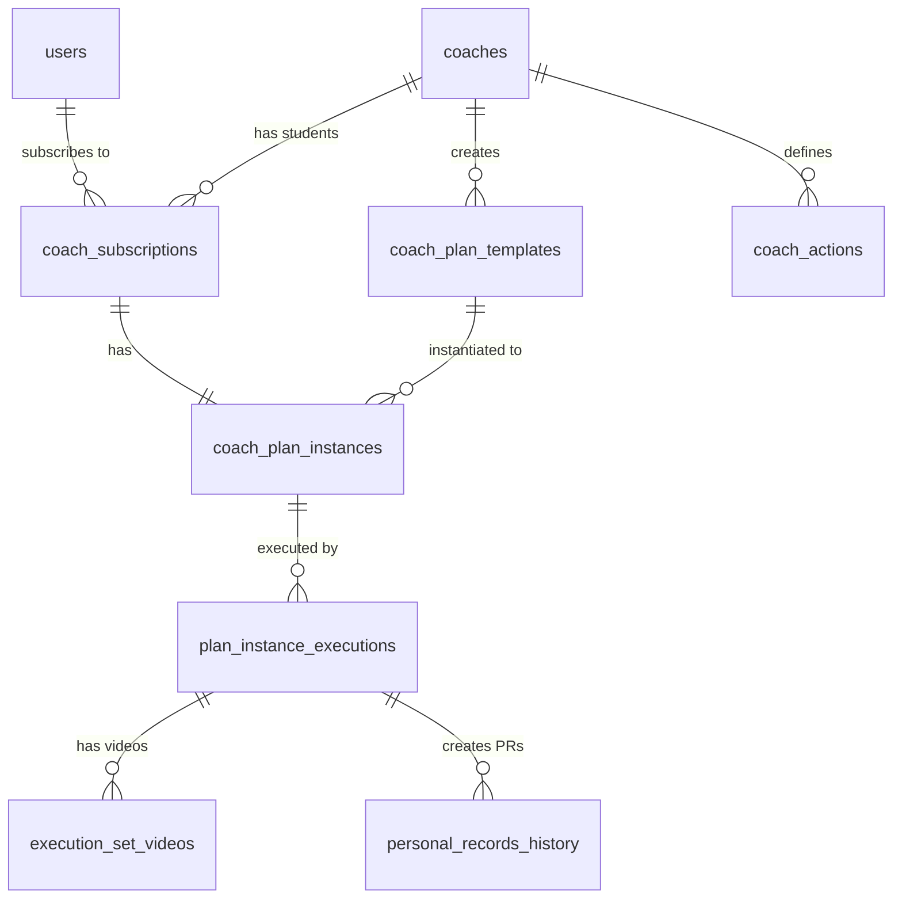
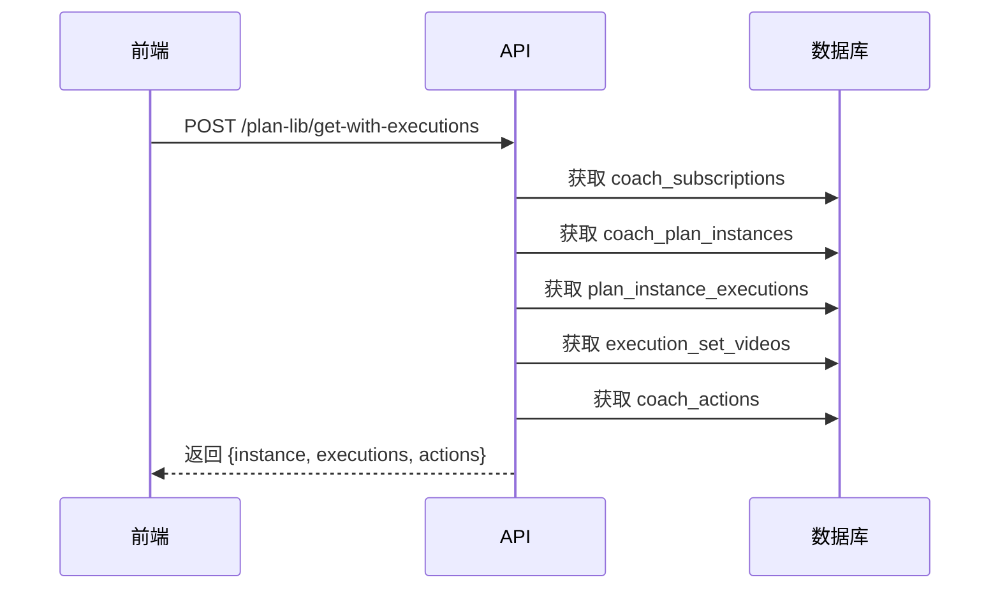
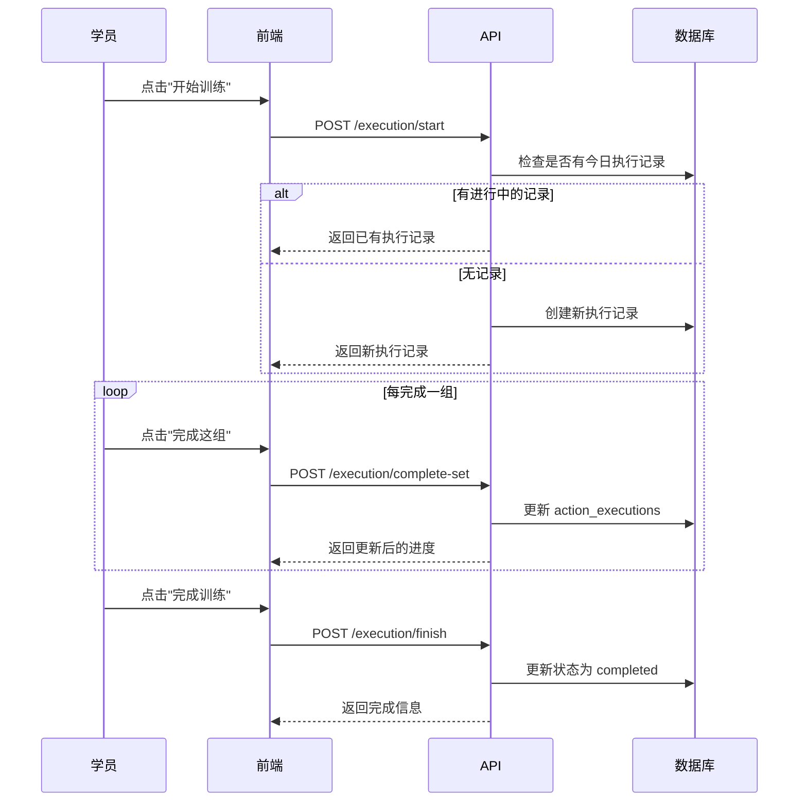
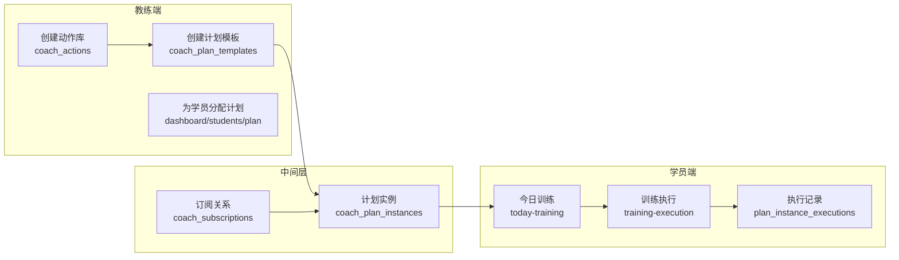

# 学员端训练功能调研报告

## 概述

本报告详细分析了 CoachLink
项目中学员端的"今日训练"和"训练计划"两个核心导航功能，从数据库结构、代码逻辑和业务流程等层面进行深入解读，并阐述其与教练端设计的计划之间的关系。

---

## 一、核心数据库表结构

### 1.1 数据表关系概览



### 1.2 核心数据表详解

#### `coach_plan_templates` - 教练计划模板

**用途**: 教练创建的可复用训练计划模板

| 字段名                | 类型     | 说明                                      |
| --------------------- | -------- | ----------------------------------------- |
| `id`                  | string   | 主键                                      |
| `coach_id`            | string   | 所属教练 ID                               |
| `name`                | string   | 模板名称                                  |
| `description`         | string   | 模板描述                                  |
| `tags`                | string[] | 标签                                      |
| `suitable_for`        | string   | 适用人群 (beginner/intermediate/advanced) |
| `training_days`       | Json[]   | 训练日配置 (包含 actionSets)              |
| `training_days_count` | number   | 训练日数量                                |
| `rest_days_count`     | number   | 休息日数量                                |

---

#### `coach_plan_instances` - 学员计划实例

**用途**: 从模板实例化的、分配给特定学员的训练计划

| 字段名                    | 类型   | 说明                    |
| ------------------------- | ------ | ----------------------- |
| `id`                      | string | 主键                    |
| `coach_id`                | string | 教练 ID                 |
| `coach_plan_template_id`  | string | 来源模板 ID (可选)      |
| `coach_subscription_id`   | string | 关联订阅 ID             |
| `student_id`              | string | 学员 ID                 |
| `name`                    | string | 计划名称                |
| `description`             | string | 计划描述                |
| `training_days`           | Json   | 训练日详情 (JSONB 数组) |
| `start_date` / `end_date` | string | 计划时间范围            |
| `status`                  | string | 计划状态                |

**`training_days` JSONB 结构**:

```typescript
interface TrainingDay {
    dayIndex: number; // 第几天 (1-7 循环)
    type: "training" | "rest"; // 训练日或休息日
    note?: string; // 备注
    actionSets: ActionSet[]; // 动作组列表
}

interface ActionSet {
    action_id: string; // 关联 coach_actions 表
    set_name: string; // 动作名称
    sets: number; // 组数
    reps: string; // 次数
    intensity?: string; // 强度/重量
    rest_seconds?: number; // 组间休息
}
```

---

#### `plan_instance_executions` - 训练执行记录

**用途**: 记录学员每次训练的执行情况

| 字段名              | 类型   | 说明                                   |
| ------------------- | ------ | -------------------------------------- |
| `id`                | string | 主键                                   |
| `instance_id`       | string | 关联计划实例                           |
| `student_id`        | string | 学员 ID                                |
| `day_index`         | number | 训练日索引                             |
| `status`            | string | 状态 (in_progress/completed/abandoned) |
| `action_executions` | Json   | 详细执行数据                           |
| `total_sets`        | number | 总组数                                 |
| `completed_sets`    | number | 已完成组数                             |
| `started_at`        | string | 开始时间                               |
| `completed_at`      | string | 完成时间                               |

**`action_executions` JSONB 结构**:

```typescript
interface ActionExecution {
    action_id: string;
    action_name: string;
    action_order: number;
    total_sets: number;
    completed_sets: number;
    sets: SetData[];
}

interface SetData {
    set_number: number;
    status: "pending" | "completed" | "skipped";
    planned_reps?: string;
    planned_weight?: string;
    actual_weight?: number;
    actual_reps?: number;
    rpe?: number;
    notes?: string;
    has_video?: boolean;
    video_url?: string;
    is_pr?: boolean;
}
```

---

#### `coach_subscriptions` - 教练订阅关系

**用途**: 学员与教练的订阅关系

| 字段名          | 类型   | 说明                     |
| --------------- | ------ | ------------------------ |
| `id`            | string | 主键                     |
| `coach_id`      | string | 教练 ID                  |
| `student_id`    | string | 学员 ID                  |
| `status`        | string | 状态 (active/expired 等) |
| `tier`          | number | 订阅等级                 |
| `monthly_price` | number | 月费                     |

---

#### `coach_actions` - 教练动作库

**用途**: 教练定义的训练动作库

| 字段名      | 类型     | 说明         |
| ----------- | -------- | ------------ |
| `id`        | string   | 主键         |
| `coach_id`  | string   | 所属教练     |
| `name`      | string   | 动作名称     |
| `detail`    | string   | 动作详情说明 |
| `url`       | string   | 教学视频 URL |
| `positions` | string[] | 目标位置     |
| `attrs`     | string[] | 属性标签     |

---

## 二、学员端"今日训练"功能分析

### 2.1 页面位置

**路由**: `/today-training`

**关键组件**:

- [page.tsx](file:///d:/files/coachlink/src/app/today-training/page.tsx) -
  主页面
- [TodayTrainingCard.tsx](file:///d:/files/coachlink/src/app/today-training/TodayTrainingCard.tsx) -
  今日训练卡片
- [BrowseSection.tsx](file:///d:/files/coachlink/src/app/today-training/BrowseSection.tsx) -
  其他训练日浏览
- [RestDayCard.tsx](file:///d:/files/coachlink/src/app/today-training/RestDayCard.tsx) -
  休息日卡片

### 2.2 功能流程

```mermaid
flowchart TD
    A[学员进入今日训练页面] --> B{检查是否有订阅}
    B -->|无订阅| C[显示"浏览教练"引导]
    B -->|有订阅| D[获取计划实例]
    D --> E{是否有计划实例?}
    E -->|无| F[显示"暂无训练计划"]
    E -->|有| G[计算今日是第几天]
    G --> H[获取今日训练日数据]
    H --> I{今日是训练日?}
    I -->|否| J[显示 RestDayCard]
    I -->|是| K[检查执行状态]
    K --> L{执行状态}
    L -->|none| M[显示"开始训练"按钮]
    L -->|in_progress| N[显示"继续训练"按钮]
    L -->|completed| O[显示"查看记录"按钮]
    M --> P[跳转到训练执行页面]
    N --> P
    O --> P
```

### 2.3 数据加载逻辑

```typescript
// 简化后的核心逻辑
const loadData = async () => {
    // 1. 获取学员的教练订阅
    const subsResponse = await subscriptionService.getCoachSubscriptions({
        studentId: session?.user?.id,
    });

    // 2. 根据订阅获取计划实例
    const res = await planLibService.getInstance({
        subscriptionId: activeSub.id,
    });

    // 3. 计算今天是第几天 (1-7 循环)
    const daysDiff = Math.floor(
        (today.getTime() - startDate.getTime()) / (1000 * 60 * 60 * 24),
    );
    const todayDayIndex = (daysDiff % 7) + 1;

    // 4. 检查今天的执行状态
    const execRes = await fetch(
        `/api/execution/check-today?instanceId=${instance.id}&dayIndex=${todayDayIndex}`,
    );
};
```

### 2.4 主要功能特性

| 功能             | 说明                                     |
| ---------------- | ---------------------------------------- |
| **教练信息展示** | 显示当前订阅教练的头像、名称、头衔       |
| **今日训练卡片** | 显示当天的训练动作列表、组数、次数、强度 |
| **执行状态追踪** | 显示已完成组数/总组数，支持"继续训练"    |
| **周历浏览**     | 可浏览一周内其他训练日的内容             |
| **休息日提示**   | 休息日显示特殊卡片，引导用户放松         |

---

## 三、学员端"训练计划"功能分析

### 3.1 页面位置

**路由**: `/training`

**关键组件**:

- [page.tsx](file:///d:/files/coachlink/src/app/training/page.tsx) -
  训练计划列表页

### 3.2 功能说明

当前"训练计划"页面的设计较为简化，主要功能包括：

1. **计划列表展示**: 展示学员拥有的所有训练计划
2. **基础信息显示**: 计划名称、描述、创建时间
3. **查看详情入口**: 点击进入计划详情

### 3.3 数据加载逻辑

```typescript
const fetchPlans = async () => {
    const res = await userService.getTrainingPlans();
    // 过滤掉没有教练ID的计划（历史孤儿计划）
    const filtered = (res.plans || []).filter((p: any) => !!p.coach_id);
    setPlans(filtered);
};
```

> [!NOTE]
> 这个页面目前功能较简化，主要是历史遗留页面。核心的训练功能已经集中在"今日训练"页面实现。

---

## 四、训练计划页面执行情况同步显示功能

### 4.1 功能概述

**路由**: `/coach/plans`

**关键组件**:
[page.tsx](file:///d:/files/coachlink/src/app/coach/plans/page.tsx)

该页面不仅显示训练计划内容，还会**同步显示学员的训练执行情况**。当学员完成部分或全部训练后，页面会在每个训练日下方展示详细的执行记录表格。

### 4.2 功能特性

| 功能             | 说明                                         |
| ---------------- | -------------------------------------------- |
| **教练选择**     | 如订阅多个教练，可切换查看不同教练的计划     |
| **计划信息展示** | 显示计划名称、描述、状态、训练/休息天数统计  |
| **训练日列表**   | 按日展示训练动作、组数、次数、强度等         |
| **执行情况同步** | 已执行的训练日显示"已执行"标签和执行详情表格 |
| **视频查看**     | 支持在弹窗中播放学员上传的训练视频           |
| **PR 标记**      | 个人记录组显示 ⭐ 星标                       |

### 4.3 核心组件：ExecutionDetailsSection

位置:
[page.tsx 第 277-352 行](file:///d:/files/coachlink/src/app/coach/plans/page.tsx#L277-L352)

该组件负责渲染学员执行情况的表格：

```typescript
const ExecutionDetailsSection = ({ execution }: { execution: any }) => {
    // 提取所有已完成的组
    const completedSets = execution.action_executions.flatMap((ae: any) =>
        (ae.sets || []).filter((s: any) => s.status === "completed").map((
            s: any,
        ) => ({
            ...s,
            action_name: ae.action_name,
        }))
    );

    // 渲染表格：动作名 | 组数 | 重量 | 次数 | RPE | 备注 | 视频
    return (
        <table>
            <thead>
                <tr>
                    <th>动作</th>
                    <th>组数</th>
                    <th>重量</th>
                    <th>次数</th>
                    <th>RPE</th>
                    <th>备注</th>
                    <th>视频</th>
                </tr>
            </thead>
            <tbody>
                {completedSets.map((set, idx) => (
                    <tr key={idx}>
                        <td>{set.action_name} {set.is_pr && "⭐"}</td>
                        <td>第 {set.set_number} 组</td>
                        <td>{set.actual_weight}kg</td>
                        <td>{set.actual_reps}</td>
                        <td>{set.rpe}</td>
                        <td>{set.notes}</td>
                        <td>{set.has_video && <VideoButton />}</td>
                    </tr>
                ))}
            </tbody>
        </table>
    );
};
```

### 4.4 数据获取：getWithExecutions API

**接口**: `POST /api/plan-lib/get-with-executions`

**文件**:
[route.ts](file:///d:/files/coachlink/src/app/api/plan-lib/get-with-executions/route.ts)

**功能**: 获取计划实例及其所有执行数据，包括视频URL



**返回数据结构**:

```typescript
interface GetWithExecutionsResponseDto {
    instance: CoachPlanInstanceRow;
    training_days: TrainingDay[];
    executions: Record<number, ExecutionRecord>; // dayIndex -> execution
    actions: Record<string, ActionInfo>; // action_id -> action
}
```

**关键逻辑**:

1. 按 `dayIndex` 聚合执行记录（每天只保留最新的一条）
2. 将 `execution_set_videos` 表中的视频URL合并到
   `action_executions.sets.video_url`
3. 获取动作库详情以显示动作名称

### 4.5 数据流程图

```mermaid
flowchart TD
    A[进入训练计划页面] --> B[获取订阅列表]
    B --> C[选择当前教练]
    C --> D[调用 getInstance API]
    D --> E[调用 getWithExecutions API]
    E --> F[获取执行记录]
    
    F --> G{遍历每个训练日}
    G --> H{该日有执行记录?}
    H -->|是| I[显示"已执行"标签]
    I --> J[渲染 ExecutionDetailsSection]
    J --> K[显示执行详情表格:<br/>动作/组数/重量/次数/RPE/备注/视频]
    H -->|否| L[仅显示计划内容]
```

### 4.6 使用位置

在 `TrainingDayCard` 组件中，执行详情组件会在训练日卡片底部渲染：

```typescript
// 位置: page.tsx 第 354-433 行
const TrainingDayCard = ({ day }: { day: TrainingDay }) => {
    const dayExecution = executions[day.dayIndex]; // 从状态获取该日执行数据
    
    return (
        <div className="border rounded-xl">
            {/* 训练日头部 - 显示"已执行"徽章 */}
            <div className="flex items-center justify-between">
                {dayExecution && <Badge value="已执行" severity="success" />}
            </div>
            
            {/* 动作列表 */}
            {actionSets.map(actionSet => <ActionItem ... />)}
            
            {/* 执行详情 - 核心展示 */}
            {dayExecution && (
                <ExecutionDetailsSection execution={dayExecution} />
            )}
        </div>
    );
};
```

---

## 五、训练执行流程

### 5.1 页面位置

**路由**: `/training-execution/[instanceId]?dayIndex=X`

**关键组件**:

- [page.tsx](file:///d:/files/coachlink/src/app/training-execution/[instanceId]/page.tsx) -
  训练执行页面

### 5.2 API 接口

| 接口                                   | 功能             |
| -------------------------------------- | ---------------- |
| `POST /api/execution/start`            | 开始或恢复训练   |
| `POST /api/execution/complete-set`     | 完成单组训练     |
| `POST /api/execution/finish`           | 完成整个训练     |
| `POST /api/execution/upload-set-video` | 上传训练视频     |
| `POST /api/execution/create-pr`        | 创建个人记录     |
| `GET /api/execution/check-today`       | 检查今日执行状态 |

### 5.3 执行流程



---

## 六、教练端与学员端的关系

### 6.1 数据流动关系



### 6.2 教练端计划分配流程

**路由**: `/dashboard/students/plan/[subscriptionId]`

**关键组件**:
[page.tsx](file:///d:/files/coachlink/src/app/dashboard/students/plan/[id]/page.tsx)

#### 教练创建计划的两种方式：

1. **从模板创建**
   - 选择已有模板 → 自动填充基本信息和训练日配置
   - 可以基于模板进行个性化修改

2. **手动创建**
   - 从空白开始，逐天配置训练内容
   - 选择训练日/休息日类型
   - 添加动作、设置组数、次数、强度等

#### 核心数据转化流程：

```typescript
// 教练保存计划时
const handleSave = async () => {
    const daysData = days.map((day) => ({
        dayIndex: day.dayIndex,
        type: day.type,
        note: day.note,
        actionSets: day.actionSets, // 包含 action_id, sets, reps, intensity 等
    }));

    if (instanceExists) {
        // 更新已有实例
        await planLibService.updateInstance({
            id: instanceId,
            name,
            description,
            trainingDays: daysData,
        });
    } else {
        // 创建新实例
        await planLibService.createInstance({
            subscriptionId: params.id,
            templateId: selectedTemplateId,
            name,
            description,
            trainingDays: daysData,
        });
    }
};
```

### 6.3 关联关系总结

| 教练端操作     | 数据表变化                      | 学员端影响                 |
| -------------- | ------------------------------- | -------------------------- |
| 创建动作库     | `coach_actions` 新增记录        | 动作可被引用到计划中       |
| 创建计划模板   | `coach_plan_templates` 新增记录 | 可快速复用于多个学员       |
| 为学员分配计划 | `coach_plan_instances` 新增记录 | 学员"今日训练"显示计划内容 |
| 修改学员计划   | `coach_plan_instances` 更新     | 学员看到更新后的训练安排   |

---

## 七、关键代码路径汇总

### 7.1 学员端

| 功能         | 文件路径                                           |
| ------------ | -------------------------------------------------- |
| 今日训练主页 | `src/app/today-training/page.tsx`                  |
| 今日训练卡片 | `src/app/today-training/TodayTrainingCard.tsx`     |
| 周历浏览     | `src/app/today-training/BrowseSection.tsx`         |
| 训练执行页   | `src/app/training-execution/[instanceId]/page.tsx` |
| 训练计划列表 | `src/app/training/page.tsx`                        |

### 7.2 教练端

| 功能         | 文件路径                                        |
| ------------ | ----------------------------------------------- |
| 学员计划编辑 | `src/app/dashboard/students/plan/[id]/page.tsx` |
| 计划查看     | `src/app/coach/plans/page.tsx`                  |
| 模板管理     | `src/app/dashboard/plan-lib/`                   |

### 7.3 API 层

| 功能         | 文件路径                                     |
| ------------ | -------------------------------------------- |
| 获取计划实例 | `src/app/api/plan-lib/get-instance/route.ts` |
| 创建计划实例 | `src/app/api/plan-lib/create-instance/`      |
| 更新计划实例 | `src/app/api/plan-lib/update-instance/`      |
| 开始训练执行 | `src/app/api/execution/start/route.ts`       |
| 完成训练组   | `src/app/api/execution/complete-set/`        |
| 完成训练     | `src/app/api/execution/finish/`              |

### 7.4 服务层

| 功能     | 文件路径                                 |
| -------- | ---------------------------------------- |
| 计划服务 | `src/app/service/planLibService.ts`      |
| 订阅服务 | `src/app/service/subscriptionService.ts` |
| 执行服务 | `src/app/service/executionService.ts`    |

---

## 八、数据类型定义位置

| 类型         | 文件路径                                         |
| ------------ | ------------------------------------------------ |
| 数据库表类型 | `src/types/database.types.ts`                    |
| 业务类型导出 | `src/types/index.ts`                             |
| API DTO 类型 | `src/app/api/*/entity.ts`                        |
| 执行相关类型 | `src/app/api/execution/entity.ts`                |
| 模板创建类型 | `src/app/api/plan-lib/create-template/entity.ts` |

---

## 九、总结

CoachLink 的训练功能采用了清晰的分层架构：

1. **教练端**: 负责创建动作库、计划模板，并为学员分配个性化计划
2. **数据层**: 通过 `coach_subscriptions` 建立教练-学员关系，通过
   `coach_plan_instances` 存储学员专属计划
3. **学员端**: 通过订阅关系查找计划实例，展示每日训练内容，并记录执行详情

核心设计理念是"**模板复用 +
个性化实例化**"，既保证了教练的工作效率，又能为每个学员提供定制化的训练体验。
