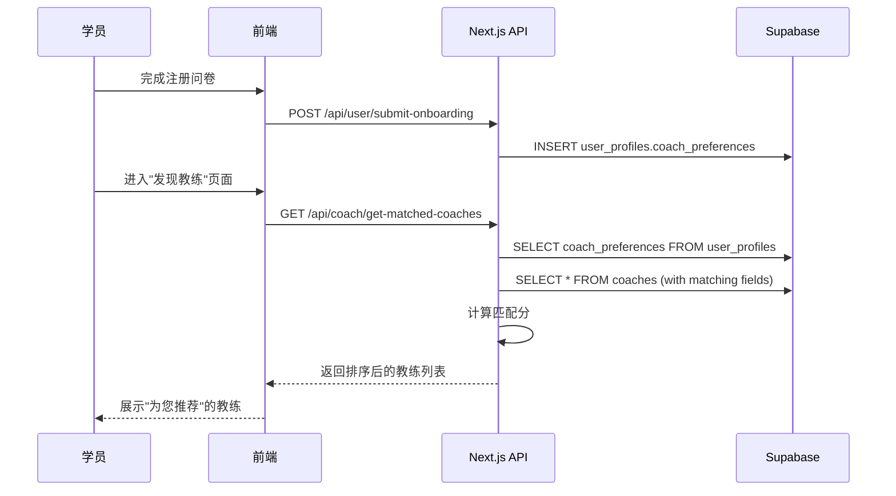

# 学员-教练智能匹配系统 - 产品需求文档 (PRD)

## 版本信息
| 版本 | 日期 | 作者 | 变更说明 |
|------|------|------|----------|
| v1.0 | 2026-02-04 | AI Assistant | 初稿，待评审 |

---

## 1. 概述与背景

### 1.1 问题陈述
当前 CoachLink 平台的「寻找教练」功能仅提供了简单的教练列表浏览。学员只能通过手动筛选（擅长领域）来寻找教练，存在以下问题：

| 问题 | 影响 |
|------|------|
| **信息采集不足** | 学员注册问卷（OnboardingModal）采集的信息与教练能力维度不对齐，无法形成匹配依据。 |
| **教练画像单薄** | 教练申请表（coach_applications）缺乏足够的结构化数据（如擅长用户类型、带训偏好、价格区间等），导致推荐无据可依。 |
| **匹配能力缺失** | 目前没有任何算法或逻辑将学员需求与教练能力进行关联，学员只能"大海捞针"。 |
| **转化率低** | 学员找不到合适教练 → 放弃付费 → 平台收入受损。 |

**核心目标：** 通过升级**学员信息采集**和**教练认证信息**，建立结构化的「需求-供给」数据模型，最终实现学员与教练的智能匹配推荐。

---

## 2. 系统现状分析

### 2.1 学员信息采集现状（OnboardingModal）

当前学员注册时采集的信息如下（位于 `src/components/auth/OnboardingModal.tsx`）：

```typescript
interface FormData {
    nickname: string;       // 昵称
    birthday: Date | null;  // 出生日期
    age: number | null;     // 年龄（由生日计算）
    gender: string;         // 性别 (male/female)
    height: number | null;  // 身高 (cm)
    weight: number | null;  // 体重 (kg)
    lifestyle: string;      // [未启用]
    fitnessGoal: string;    // 健身目标 (减脂/增肌/力量提升/体能改善)
    fitnessLevel: string;   // 运动水平 (beginner/intermediate/advanced)
    sportCards: SportCards; // 感兴趣的运动领域 + 历史成绩
}
```

**问题分析：**
- ✅ 基础信息（年龄、性别、身高、体重）已采集，可用于基础筛选。
- ❌ **缺少训练频次偏好**（每周几次？线上/线下？）
- ❌ **缺少预算范围**（愿意花多少钱请教练？）
- ❌ **缺少时间偏好**（工作日/周末？上午/下午/晚上？）
- ❌ **缺少特殊需求/禁忌**（伤病史、饮食限制等，与教练擅长康复的匹配）
- ❌ **缺少教练偏好**（希望教练年龄/性别/风格）

---

### 2.2 教练信息采集现状（CoachApplication）

当前教练申请时采集的信息如下（位于 `src/app/coach/application/page.tsx`）：

```typescript
formData = {
    name: '',                 // 姓名
    title: '',                // 称号/头衔
    bio: '',                  // 个人简介
    yearsExperience: 0,       // 教学年限
    teachingPhilosophy: '',   // 教学理念
    contactEmail: '',         // 联系邮箱
    contactPhone: '',         // 联系电话
    specialties: [],          // 专业领域 (数组，如 ['减脂', '力量训练'])
    achievements: [],         // 成就奖项
    caseStudies: [],          // 代表案例
    credentials: [],          // 资质证书 {name, url}
    socialLinks: []           // 社交媒体链接
}
```

**问题分析：**
- ✅ 专业领域（specialties）可用于初步匹配学员的 fitnessGoal。
- ❌ **缺少服务模式**（在线/线下/混合？）
- ❌ **缺少服务价格区间**（无法与学员预算匹配）
- ❌ **缺少擅长用户类型**（小白/进阶/竞技？男/女/无偏好？）
- ❌ **缺少可服务时间段**（工作日/周末？时间范围？）
- ❌ **缺少地理位置**（无法做同城/附近匹配）
- ❌ **缺少教学风格自述**（严格型/鼓励型/学术型？）

---

## 3. 匹配维度模型设计

为了实现精准匹配，我们定义以下核心匹配维度。每个维度需要在学员端和教练端同时采集对应信息：

### 3.1 匹配维度映射表

| 匹配维度 | 学员端采集项（需求侧） | 教练端采集项（供给侧） | 匹配逻辑 |
|----------|------------------------|------------------------|----------|
| **目标方向** | 健身目标（fitnessGoal） | 擅长领域（specialties） | 交集匹配 |
| **水平层次** | 运动水平（fitnessLevel） | 擅长用户类型（targetUserLevel） | 包含关系匹配 |
| **服务模式** | 授课方式偏好（preferredMode：线上/线下/均可） | 服务模式（serviceMode：线上/线下/混合） | 交集匹配 |
| **价格区间** | 预算范围（budgetRange：低/中/高） | 最低服务单价 or 价格档位 | 区间匹配 |
| **时间偏好** | 可训练时段（preferredTime：工作日/周末 + 早/午/晚） | 可服务时段（availableTime） | 交集匹配 |
| **地理位置** | 当前城市（city） | 服务城市/坐标（city/lat/lng） | 同城优先 |
| **特殊需求** | 伤病/禁忌（healthIssues） | 擅长康复/特殊人群（specialPopulation） | 关键词匹配 |
| **教练风格** | 期望教练风格（coachStyle：严格/温和/专业） | 自述教学风格（teachingStyle） | 偏好匹配 |

---

## 4. 详细功能需求

### 4.1 学员端：注册问卷优化（OnboardingModal 升级）

#### 4.1.1 新增采集字段

在现有 3 步问卷基础上，建议增加第 4 步「找教练偏好」（或合并为 Step 2 的扩展部分），新增以下字段：

| 字段名 | 中文名 | 类型 | 选项示例 | 必填 |
|--------|--------|------|----------|------|
| `preferredMode` | 授课方式偏好 | 单选 | 线上远程 / 线下面对面 / 都可以 | 否 |
| `budgetRange` | 月度训练预算 | 单选 | 300元以下 / 300-800元 / 800-1500元 / 1500元以上 | 否 |
| `preferredSchedule` | 偏好训练时段 | 多选 | 工作日早晨 / 工作日晚间 / 周末全天 / 随时可约 | 否 |
| `healthIssues` | 伤病/特殊情况 | 多选+文本 | 无 / 膝盖受伤 / 腰椎问题 / 肩袖损伤 / 其他（填写） | 否 |
| `coachGenderPreference` | 教练性别偏好 | 单选 | 无偏好 / 希望同性教练 | 否 |
| `coachStylePreference` | 教练风格偏好 | 单选 | 严格督促型 / 温和鼓励型 / 专业学术型 / 无偏好 | 否 |
| `currentCity` | 当前所在城市 | 省-市选择器 | 北京市-朝阳区 | 否（LBS 自动填充时非必填） |

#### 4.1.2 UI/UX 设计要点

1. **渐进式披露**：新增字段放在 Step 2 之后（运动领域选择后），作为"可选增强信息"。用标题明确告知用户："回答以下问题，帮助我们为您推荐更匹配的教练（可跳过）"。
2. **跳过机制**：允许跳过，但在教练列表页面再次引导补全（如顶部横幅："完善偏好，获得更精准推荐"）。
3. **存储位置**：新字段存入 `onboarding_questionnaires` 表或 `user_profiles` 表的 `coach_preferences` JSONB 字段。

#### 4.1.3 数据库结构建议

```sql
-- 方案一：扩展 user_profiles 表
ALTER TABLE public.user_profiles
ADD COLUMN coach_preferences JSONB DEFAULT '{}';

-- coach_preferences 结构示例：
-- {
--   "preferred_mode": "online",
--   "budget_range": "medium",
--   "preferred_schedule": ["weekday_evening", "weekend"],
--   "health_issues": ["knee_injury", "other:轻微腰突"],
--   "coach_gender_preference": "same",
--   "coach_style_preference": "encouraging"
-- }
```

---

### 4.2 教练端：认证信息升级（CoachApplication 增强）

#### 4.2.1 新增采集字段

在现有教练申请表单中，新增以下结构化字段：

| 字段名 | 中文名 | 类型 | 选项示例 | 必填 |
|--------|--------|------|----------|------|
| `serviceMode` | 服务模式 | 多选 | 纯线上 / 纯线下 / 线上+线下混合 | 是 |
| `targetUserLevel` | 擅长用户类型（水平） | 多选 | 完全小白 / 有一定基础 / 进阶训练者 / 竞技运动员 | 是 |
| `targetUserGender` | 擅长用户类型（性别） | 多选 | 男性学员 / 女性学员 / 无偏好 | 否 |
| `priceRange` | 服务价格档位 | 单选 | 入门级（<300/月）/ 中端（300-800/月）/ 高端（800+/月）| 是 |
| `availableSchedule` | 可服务时段 | 多选 | 工作日早晨 / 工作日白天 / 工作日晚间 / 周末 | 是 |
| `teachingStyle` | 教学风格自述 | 单选 | 严格督促型 / 温和鼓励型 / 专业学术型 | 否 |
| `specialPopulation` | 擅长特殊人群 | 多选 | 产后恢复 / 老年健身 / 青少年体能 / 运动康复 / 无 | 否 |
| `city` | 常驻城市 | 省-市选择器 | 北京市-朝阳区 | 是（线下/混合模式时必填） |
| `address` | 详细地址/场馆 | 文本 | 朝阳公园南门健身房 | 否 |
| `latitude` / `longitude` | 坐标 | 隐藏（地图选点回填） | 39.9042, 116.4074 | 否 |

#### 4.2.2 UI/UX 设计要点

1. **分组展示**：将表单分为"基础信息"、"服务信息"、"教学特点"三个区块，避免一眼看到太多字段。
2. **条件联动**：
   - 选择「服务模式 = 纯线上」时，隐藏地址/坐标字段。
   - 选择「服务模式 = 线下/混合」时，城市和地址变为必填，并显示地图选点。
3. **多选 UI**：使用 Chip 或 Toggle 卡片（类似 OnboardingModal 的 SportCards 选择器），提升触控友好度。

#### 4.2.3 数据库结构建议

```sql
-- 扩展 coach_applications 表
ALTER TABLE public.coach_applications
ADD COLUMN service_mode text[] DEFAULT '{}',           -- ['online', 'offline', 'hybrid']
ADD COLUMN target_user_level text[] DEFAULT '{}',     -- ['beginner', 'intermediate', 'advanced', 'athlete']
ADD COLUMN target_user_gender text[] DEFAULT '{}',    -- ['male', 'female', 'any']
ADD COLUMN price_range text,                           -- 'low', 'medium', 'high'
ADD COLUMN available_schedule text[] DEFAULT '{}',    -- ['weekday_morning', 'weekday_evening', 'weekend']
ADD COLUMN teaching_style text,                        -- 'strict', 'encouraging', 'academic'
ADD COLUMN special_population text[] DEFAULT '{}',    -- ['postpartum', 'elderly', 'youth', 'rehab']
ADD COLUMN city text,
ADD COLUMN address text,
ADD COLUMN latitude double precision,
ADD COLUMN longitude double precision;

-- 同步更新 coaches 表（审核通过后同步）
-- 可通过触发器或在审核通过时手动同步
```

---

### 4.3 匹配算法设计（后端逻辑）

#### 4.3.1 匹配流程

```
┌──────────────┐     ┌───────────────────┐     ┌────────────────────┐
│ 学员触发匹配 │ ──▶ │ 读取学员偏好数据   │ ──▶ │ 计算每位教练匹配分 │
└──────────────┘     └───────────────────┘     └────────────────────┘
                                                         │
                                                         ▼
                                              ┌────────────────────┐
                                              │ 按匹配分排序返回   │
                                              └────────────────────┘
```

#### 4.3.2 匹配分计算公式

```
匹配分（Match Score）= Σ (维度权重 × 维度匹配度)
```

| 维度 | 权重 | 匹配度计算 |
|------|------|------------|
| 目标方向 | 25% | 学员 fitnessGoal ∈ 教练 specialties → 1.0；否则 → 0 |
| 水平层次 | 15% | 学员 fitnessLevel ∈ 教练 targetUserLevel → 1.0 |
| 服务模式 | 15% | 交集非空 → 1.0；空 → 0 |
| 价格匹配 | 15% | 学员 budgetRange ≥ 教练 priceRange → 1.0；否则 → 0.5 |
| 时间匹配 | 10% | 交集数 / 最大可能交集数 |
| 地理距离 | 10% | 同城 → 1.0；同省 → 0.5；异省 → 0.2；线上模式忽略 |
| 特殊需求 | 5% | 学员 healthIssues 与教练 specialPopulation 交集 → 1.0 |
| 风格偏好 | 5% | 完全匹配 → 1.0；无偏好 → 0.8 |

#### 4.3.3 实现方式建议

**方案一：数据库函数 (Supabase RPC)**
- 在 PostgreSQL 中创建 `get_matched_coaches(user_id UUID)` 函数。
- 优点：逻辑集中、性能较好。
- 缺点：复杂逻辑 SQL 可读性差。

**方案二：后端 API 计算**
- 在 Next.js API Route 中实现匹配逻辑。
- 读取学员偏好 → 读取所有教练 → 在内存中计算分数 → 排序返回。
- 优点：灵活，易于调试和迭代。
- 缺点：当教练数量多时性能可能下降（可通过预筛选优化）。

**推荐：** 先采用方案二快速验证效果，后续优化为方案一或混合方案。

---

## 5. 前端展示需求

### 5.1 教练列表页升级

| 功能点 | 描述 |
|--------|------|
| **推荐标签** | 在教练卡片上显示"为您推荐"标签（当匹配分 > 0.7） |
| **匹配度指示** | 可选：显示匹配百分比，如"匹配度 85%" |
| **排序切换** | 新增"智能推荐"排序方式，默认启用（基于匹配分） |
| **筛选增强** | 新增按服务模式、价格区间、可预约时间筛选 |

### 5.2 教练详情页升级

| 功能点 | 描述 |
|--------|------|
| **匹配亮点** | 列出该教练与当前学员匹配的具体维度（如"目标一致：力量提升 ✓"） |
| **服务信息卡片** | 展示：服务模式、价格区间、可预约时段、擅长人群 |
| **距离展示** | 如果是同城教练，显示大致距离 |

---

## 6. 数据流与系统交互



---

## 7. 验收标准 (Acceptance Criteria)

### 7.1 学员问卷

1. ✅ 新用户注册时可选填授课方式偏好、预算范围、时间偏好、伤病情况、教练风格偏好。
2. ✅ 填写的信息正确存入 `user_profiles.coach_preferences` 字段。
3. ✅ 跳过时不阻塞注册流程。

### 7.2 教练认证

1. ✅ 教练申请时必须选择服务模式、价格档位、可服务时段。
2. ✅ 选择线下/混合模式时，城市为必填。
3. ✅ 填写的信息正确存入 `coach_applications` 表对应字段。
4. ✅ 审核通过后，信息同步至 `coaches` 表。

### 7.3 匹配推荐

1. ✅ 调用 `/api/coach/get-matched-coaches` 返回按匹配分排序的教练列表。
2. ✅ 匹配分 > 0.7 的教练显示"为您推荐"标签。
3. ✅ 学员未填写偏好时，退回默认排序（如按评分/学员数）。

---

## 8. 优先级与排期建议

| 阶段 | 内容 | 建议时间 |
|------|------|----------|
| **Phase 1** | 学员问卷新增字段 + 数据库迁移 | 1-2 天 |
| **Phase 2** | 教练申请表单新增字段 + 数据库迁移 | 1-2 天 |
| **Phase 3** | 匹配算法后端实现 (API) | 2-3 天 |
| **Phase 4** | 教练列表/详情页前端适配 | 2 天 |
| **Phase 5** | 测试与调优 | 1-2 天 |

**总计：约 1-2 周**

---

## 9. 附录

### 9.1 相关代码文件

| 文件 | 用途 |
|------|------|
| `src/components/auth/OnboardingModal.tsx` | 学员注册问卷组件 |
| `src/app/coach/application/page.tsx` | 教练申请表单页面 |
| `src/app/api/coach/create-coach-application/route.ts` | 创建教练申请 API |
| `src/app/coach/subscription/CoachList.tsx` | 教练列表展示组件 |
| `src/types/database.types.ts` | 数据库类型定义 |

### 9.2 相关数据库表

| 表名 | 用途 |
|------|------|
| `user_profiles` | 存储学员基础信息 |
| `onboarding_questionnaires` | 存储学员问卷答案 |
| `coach_applications` | 存储教练申请信息 |
| `coaches` | 存储审核通过的教练信息 |

---

## 10. 待讨论事项

> [!IMPORTANT]
> **以下问题需要与产品/运营确认：**

1. **匹配维度权重**：上述权重分配是否合理？是否需要根据业务数据调整？
2. **价格展示**：教练价格是否公开展示在列表/详情页？还是仅作为匹配依据、实际价格私聊协商？
3. **偏好补全引导**：学员跳过偏好问题后，多久/何时再次引导补全？是否影响使用？
4. **教练审核流程**：新增字段后，审核员是否需要额外审核这些信息（如价格虚标）？
