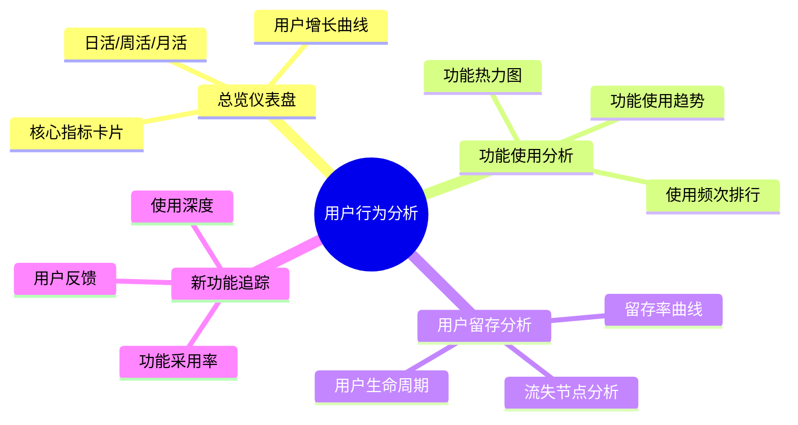

嗯# CoachLink 管理后台 - 用户行为分析系统需求文档

## 1. 背景与目标

### 1.1 背景分析

基于对项目的深入分析，CoachLink 平台目前具备以下核心功能：

| 用户类型     | 核心功能模块                                                             |
| ------------ | ------------------------------------------------------------------------ |
| **教练端**   | 计划库管理、动作库管理、学员管理、问卷定制、订阅管理、聊天沟通、内容发布 |
| **学员端**   | 今日训练、训练执行、视频上传、个人档案、好友互动、排行榜、自建计划       |
| **管理后台** | 支付管理、教练申请审核、排行榜管理、平台设置                             |

### 1.2 目标

构建**用户行为分析系统**，帮助产品团队：

1. **了解高频功能** - 识别用户真正需要和高频使用的功能
2. **发现痛点** - 通过行为漏斗分析找出用户流失节点
3. **评估新功能** - 追踪新功能上线后的采用率和使用情况
4. **指导产品决策** - 用数据驱动产品优化方向

---

## 2. 需求概述

### 2.1 管理后台新增模块

在现有管理后台的基础上，新增**「用户分析」**标签页：

```
现有管理后台 Tabs:
├── 支付管理
├── 教练申请
├── 排行榜
├── 平台设置
└── [新增] 用户分析 ⬅️
```

### 2.2 核心分析维度



---

## 3. 详细功能设计

### 3.1 总览仪表盘 (Dashboard)

提供平台核心指标的快速概览。

#### 3.1.1 核心指标卡片

| 指标               | 说明                 | 数据来源                            |
| ------------------ | -------------------- | ----------------------------------- |
| **DAU/WAU/MAU**    | 日活/周活/月活用户数 | user_behavior_events                |
| **新增用户**       | 今日/本周新注册用户  | users.created_at                    |
| **活跃教练数**     | 近7天有操作的教练    | 教练行为事件                        |
| **活跃学员数**     | 近7天有训练的学员    | training_records                    |
| **今日训练完成数** | 今天完成的训练记录   | training_records.status='completed' |
| **今日视频上传数** | 今天上传的训练视频   | set_videos.created_at               |
| **活跃订阅数**     | 当前有效订阅数量     | coach_subscriptions.status='active' |

#### 3.1.2 趋势图表

- **用户增长曲线** - 注册用户累计趋势（按日/周/月）
- **活跃度趋势** - DAU/WAU/MAU 趋势对比
- **功能使用分布** - 饼图展示各功能模块使用占比

---

### 3.2 功能使用分析

> **核心价值**：识别高频功能，了解用户真实需求

#### 3.2.1 需要埋点追踪的核心功能

**教练端功能：**

| 功能模块 | 事件名称                     | 事件描述           |
| -------- | ---------------------------- | ------------------ |
| 计划库   | `coach_plan_template_create` | 创建计划模板       |
| 计划库   | `coach_plan_template_edit`   | 编辑计划模板       |
| 计划库   | `coach_plan_instance_create` | 为学员创建计划实例 |
| 计划库   | `coach_plan_ai_import`       | 使用 AI 导入计划   |
| 动作库   | `coach_action_create`        | 创建动作           |
| 动作库   | `coach_action_video_upload`  | 上传动作视频       |
| 学员管理 | `coach_student_view_profile` | 查看学员档案       |
| 学员管理 | `coach_student_view_records` | 查看学员训练记录   |
| 问卷     | `coach_questionnaire_edit`   | 编辑入驻问卷       |
| 聊天     | `coach_message_send`         | 发送消息           |
| 聊天     | `coach_video_review`         | 点评学员视频       |
| 内容     | `coach_content_publish`      | 发布内容           |

**学员端功能：**

| 功能模块 | 事件名称                       | 事件描述             |
| -------- | ------------------------------ | -------------------- |
| 训练     | `student_training_start`       | 开始今日训练         |
| 训练     | `student_training_complete`    | 完成训练             |
| 训练     | `student_set_complete`         | 完成单组训练         |
| 训练     | `student_video_upload`         | 上传训练视频         |
| 训练     | `student_weight_adjust`        | 调整训练重量         |
| 个人档案 | `student_profile_update`       | 更新个人资料         |
| 个人档案 | `student_1rm_update`           | 更新极限数据         |
| 社交     | `student_friend_add`           | 添加好友             |
| 社交     | `student_ranking_view`         | 查看排行榜           |
| 社交     | `student_ranking_submit`       | 提交排行榜成绩       |
| 自建计划 | `student_self_plan_create`     | 创建自主计划         |
| 自建计划 | `student_action_lib_copy`      | 复制教练动作到自己库 |
| 订阅     | `student_coach_subscribe`      | 订阅教练             |
| 订阅     | `student_questionnaire_submit` | 提交入驻问卷         |
| 聊天     | `student_message_send`         | 发送消息             |

#### 3.2.2 分析视图

**功能热力图：**

```
┌─────────────────────────────────────────────────┐
│            功能使用热力图 (近7天)                 │
├─────────────────────────────────────────────────┤
│ ████████████████████████████ 今日训练 (2,847次)  │
│ ██████████████████████ 完成训练 (1,923次)        │
│ ████████████████████ 视频上传 (1,654次)          │
│ ██████████████ 查看排行榜 (1,102次)              │
│ ████████████ 发送消息 (892次)                    │
│ ██████████ 更新极限数据 (721次)                  │
│ ████████ 创建计划 (543次)                        │
│ ██████ AI导入 (412次)                           │
│ ████ 发布内容 (234次)                           │
└─────────────────────────────────────────────────┘
```

**功能使用趋势：**

- 支持选择多个功能对比趋势
- 时间范围：近7天/近30天/近3个月
- 支持按用户类型筛选（教练/学员）

**功能使用明细：**

- 表格展示每个功能的详细数据
- 支持导出 CSV

---

### 3.3 用户留存分析

> **核心价值**：发现流失节点，提升用户留存

#### 3.3.1 留存率视图

**N日留存矩阵：**

| 日期 | 新用户 | 次日留存 | 3日留存 | 7日留存 | 14日留存 | 30日留存 |
| ---- | ------ | -------- | ------- | ------- | -------- | -------- |
| 1/20 | 127    | 68%      | 52%     | 41%     | 35%      | 28%      |
| 1/19 | 143    | 71%      | 55%     | 43%     | 36%      | -        |
| 1/18 | 112    | 65%      | 48%     | 38%     | -        | -        |

**留存曲线图：**

- 横轴：注册后天数
- 纵轴：留存率
- 分组对比：教练 vs 学员

#### 3.3.2 关键行为分析

**「Aha Moment」发现：**

追踪用户首次完成关键行为的时间，找出与高留存相关的行为：

| 关键行为     | 首周完成率 | 留存影响    |
| ------------ | ---------- | ----------- |
| 完成首次训练 | 78%        | 留存率 +45% |
| 上传首个视频 | 45%        | 留存率 +32% |
| 添加首个好友 | 23%        | 留存率 +28% |
| 收到教练反馈 | 34%        | 留存率 +52% |

---

### 3.4 新功能采用分析

> **核心价值**：评估新功能效果，指导迭代方向

#### 3.4.1 功能发布追踪

支持标记新功能发布日期，自动追踪：

```
┌────────────────────────────────────────────────┐
│  新功能追踪：AI 计划导入                         │
├────────────────────────────────────────────────┤
│  发布日期：2026-01-15                           │
│  ─────────────────────────────────────         │
│  📊 采用情况：                                  │
│     • 累计使用用户：234 人 (占全部教练的 45%)    │
│     • 首周采用率：28%                           │
│     • 平均使用频次：2.3 次/周                   │
│  ─────────────────────────────────────         │
│  📈 使用趋势：                                  │
│     [图表：发布后每日使用量]                     │
│  ─────────────────────────────────────         │
│  👥 用户细分：                                  │
│     • 重度用户 (5+次/周)：12%                   │
│     • 中度用户 (2-4次/周)：35%                  │
│     • 轻度用户 (1次/周)：53%                    │
└────────────────────────────────────────────────┘
```

#### 3.4.2 功能标记管理

管理员可以：

- 添加新功能标记（功能名称、发布日期、关联事件）
- 查看历史功能采用报告
- 对比不同功能的采用曲线

---

## 4. 技术设计

### 4.1 数据库设计

#### 4.1.1 用户行为事件表

```sql
CREATE TABLE user_behavior_events (
    id              uuid PRIMARY KEY DEFAULT gen_random_uuid(),
    user_id         uuid NOT NULL,
    user_type       text NOT NULL,  -- 'coach' | 'student' | 'admin'
    event_name      text NOT NULL,  -- 事件名称
    event_category  text NOT NULL,  -- 事件分类
    event_data      jsonb,          -- 事件附加数据
    page_path       text,           -- 页面路径
    session_id      text,           -- 会话ID
    device_type     text,           -- 设备类型
    created_at      timestamptz DEFAULT now()
);

-- 索引
CREATE INDEX idx_events_user_id ON user_behavior_events(user_id);
CREATE INDEX idx_events_name ON user_behavior_events(event_name);
CREATE INDEX idx_events_created_at ON user_behavior_events(created_at);
CREATE INDEX idx_events_category ON user_behavior_events(event_category);
```

#### 4.1.2 功能标记表

```sql
CREATE TABLE feature_releases (
    id              uuid PRIMARY KEY DEFAULT gen_random_uuid(),
    name            text NOT NULL,           -- 功能名称
    description     text,                    -- 功能描述
    release_date    date NOT NULL,           -- 发布日期
    tracked_events  text[] NOT NULL,         -- 关联的事件名称数组
    target_users    text DEFAULT 'all',      -- 'coach' | 'student' | 'all'
    is_active       boolean DEFAULT true,
    created_at      timestamptz DEFAULT now()
);
```

#### 4.1.3 统计聚合视图

```sql
-- 每日活跃用户统计
CREATE MATERIALIZED VIEW daily_active_users AS
SELECT 
    date_trunc('day', created_at) AS date,
    user_type,
    COUNT(DISTINCT user_id) AS active_users
FROM user_behavior_events
GROUP BY date_trunc('day', created_at), user_type;

-- 功能使用统计
CREATE MATERIALIZED VIEW feature_usage_stats AS
SELECT 
    date_trunc('day', created_at) AS date,
    event_name,
    event_category,
    COUNT(*) AS usage_count,
    COUNT(DISTINCT user_id) AS unique_users
FROM user_behavior_events
GROUP BY date_trunc('day', created_at), event_name, event_category;
```

### 4.2 前端埋点方案

#### 4.2.1 埋点 Hook

```typescript
// src/hooks/useAnalytics.ts
export function useAnalytics() {
    const trackEvent = useCallback((
        eventName: string,
        eventData?: Record<string, unknown>,
    ) => {
        analyticsService.track(eventName, eventData);
    }, []);

    return { trackEvent };
}
```

#### 4.2.2 使用示例

```tsx
function TrainingPage() {
    const { trackEvent } = useAnalytics();

    const handleStartTraining = () => {
        trackEvent("student_training_start", {
            planId: currentPlan.id,
            dayIndex: currentDay,
        });
        // ... 业务逻辑
    };
}
```

### 4.3 API 设计

| 接口                                    | 方法     | 说明             |
| --------------------------------------- | -------- | ---------------- |
| `/api/analytics/track`                  | POST     | 上报行为事件     |
| `/api/admin/analytics/dashboard`        | GET      | 获取仪表盘数据   |
| `/api/admin/analytics/feature-usage`    | GET      | 获取功能使用统计 |
| `/api/admin/analytics/retention`        | GET      | 获取留存分析数据 |
| `/api/admin/analytics/feature-releases` | GET/POST | 管理功能发布标记 |

---

## 5. 实现阶段规划

### 阶段一：基础设施（1-2天）

- [ ] 创建数据库表和索引
- [ ] 实现事件上报 API
- [ ] 创建前端埋点 Hook

### 阶段二：核心埋点（2-3天）

- [ ] 训练相关功能埋点
- [ ] 计划管理功能埋点
- [ ] 社交功能埋点
- [ ] 订阅流程埋点

### 阶段三：管理后台（3-4天）

- [ ] 总览仪表盘页面
- [ ] 功能使用分析页面
- [ ] 用户留存分析页面
- [ ] 新功能追踪页面

### 阶段四：优化迭代（持续）

- [ ] 数据可视化优化
- [ ] 导出报表功能
- [ ] 自动化报告推送

---

## 6. 用户需要确认的问题

> [!IMPORTANT]
> 请确认以下问题，以便进一步细化需求：

1. **数据保留周期**：行为事件数据需要保留多长时间？（建议：3个月原始数据 +
   聚合数据永久保留）

2. **访问权限**：用户分析功能是否只对超级管理员开放？还是所有管理员都可以查看？

3. **实时性要求**：统计数据需要实时更新还是可以接受一定延迟？（如：每小时刷新）

4. **隐私考虑**：是否需要支持用户行为数据的匿名化处理？

5. **优先级排序**：以下功能模块的优先级如何排序？
   - 总览仪表盘
   - 功能使用分析
   - 用户留存分析
   - 新功能追踪

6. **导出需求**：是否需要支持数据导出（CSV/Excel）？是否需要定期自动发送报告邮件？

---

## 7. 预期产出

完成后，管理后台将新增完整的用户行为分析模块：

```
/admin/analytics                    # 用户分析入口
├── /admin/analytics/dashboard      # 总览仪表盘
├── /admin/analytics/features       # 功能使用分析
├── /admin/analytics/retention      # 用户留存分析
└── /admin/analytics/releases       # 新功能追踪
```

通过这个系统，你可以：

- ✅ 实时了解哪些功能被高频使用
- ✅ 发现用户流失的关键节点
- ✅ 评估新功能的采用效果
- ✅ 用数据驱动产品迭代决策
