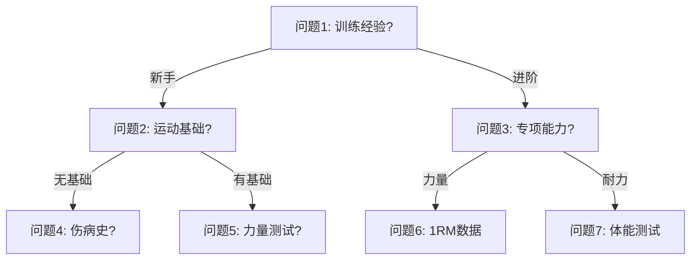

# 问卷增强功能实现计划

## 需求概述

教练反馈了两个问卷增强需求：

### 功能一：问题附加媒体（图片/视频示例）

**场景**：某些问题需要视觉辅助才能让学员充分理解。例如：

- "您能完成标准引体向上吗？" → 附加一个标准引体向上的示范视频
- "您的深蹲深度如何？" → 附加不同深蹲深度的对比图片

**期望效果**：

- 教练可以为任何问题附加一张或多张图片/视频
- 学员填写问卷时，可以点击查看这些媒体来理解问题

---

### 功能二：条件分支逻辑（树状问卷）

**场景**：不同学员的训练背景差异很大，需要不同的问题路径。例如：

```
问题A: 您的训练经验？
  ├─ 选项1: 新手（< 1年）  → 跳转到「新手问题组」
  ├─ 选项2: 中级（1-3年）  → 跳转到「中级问题组」
  └─ 选项3: 进阶（> 3年）  → 跳转到「进阶问题组」
```

**期望效果**：

- 教练可以为每个选项设置"下一个问题"的跳转目标
- 学员根据自己的选择，看到不同的后续问题
- 最终不同学员的问题路径可能完全不同

---

## 设计方案

### 功能一：问题附加媒体

#### 数据结构扩展

```typescript
// 在每种问题类型中添加 media 字段
interface QuestionMedia {
    type: "image" | "video";
    url: string; // 媒体 URL（Supabase Storage）
    caption?: string; // 可选说明文字
    thumbnail?: string; // 视频缩略图（可选）
}

// 扩展现有问题类型
interface TrainingOptionQuestion {
    type: "option";
    question: string;
    options: string[];
    scope?: "global" | "action";
    userSelection?: number;
    // 新增
    media?: QuestionMedia[];
}

// 其他问题类型同理...
```

#### UI 设计（教练端）

```
┌─────────────────────────────────────────────────┐
│  问题: 您能完成标准引体向上吗？                    │
│  ─────────────────────────────────────          │
│  [+ 添加示例图片/视频]                            │
│                                                 │
│  ┌────────┐ ┌────────┐                         │
│  │ 🖼️图片1 │ │ 📹视频1 │  [×]                   │
│  └────────┘ └────────┘                         │
│                                                 │
│  选项:                                          │
│  ○ 能轻松完成10个以上                             │
│  ○ 能完成1-10个                                  │
│  ○ 完全无法完成                                   │
└─────────────────────────────────────────────────┘
```

#### UI 设计（学员端）

```
┌─────────────────────────────────────────────────┐
│  您能完成标准引体向上吗？  [👁 查看示例]            │
│                                                 │
│  ○ 能轻松完成10个以上                             │
│  ○ 能完成1-10个                                  │
│  ○ 完全无法完成                                   │
└─────────────────────────────────────────────────┘
```

---

### 功能二：条件分支逻辑（多层树状问卷）

**场景**：

- 支持**无限层级**的分支跳转（A -> B -> C -> D...）
- 最终形成一个树状或网状的问卷结构
- 提供**可视化预览图**，帮助教练理解复杂的跳转逻辑

**数据结构扩展**： （保持 ID 映射方式，这种方式天然支持多层）

```typescript
// 问题配置中增加 branching 字段
interface QuestionBranching {
    // 选项值(index) -> 下一个问题ID
    rules: Record<number, string>;
    // 默认跳转（可选）
    defaultNext?: string | null;
}

// 每个问题需要一个唯一 ID
interface QuestionWithBranching {
    id: string; // 唯一标识符（已有）
    type: QuestionType;
    // ... 其他现有字段

    // 新增：分支逻辑
    branching?: QuestionBranching;
}

// 问卷配置扩展
interface QuestionnaireConfig {
    questions: QuestionWithBranching[];
    // 新增：起始问题 ID
    startQuestionId?: string;
    // 新增：是否启用分支模式
    branchingEnabled?: boolean;
}
```

#### 分支逻辑示例

```json
{
    "questions": [
        {
            "id": "q1",
            "type": "option",
            "question": "您的训练经验？",
            "options": ["新手", "中级", "进阶"],
            "branching": {
                "rules": {
                    "0": "q2-beginner",
                    "1": "q2-intermediate",
                    "2": "q2-advanced"
                }
            }
        },
        {
            "id": "q2-beginner",
            "type": "option",
            "question": "您有任何运动伤病史吗？",
            "options": ["没有", "有，但已恢复", "有，仍在康复"],
            "branching": {
                "rules": { "0": "q3", "1": "q3", "2": "q-injury" }
            }
        }
        // ... 更多问题
    ],
    "startQuestionId": "q1",
    "branchingEnabled": true
}
```

#### UI 设计：编辑与预览

**1. 编辑模式（列表/卡片式）**

- 保持现有的卡片式编辑体验
- 在每个选项旁边添加「跳转至」下拉框（选择后续问题或"结束"）
- 增加「预览路径」按钮，点击可查看当前问卷的逻辑流向图

**2. 可视化预览（路线展示图）**

- 使用 **Mermaid.js** 或 **React Flow** 渲染问卷结构图
- 展示问题之间的连接关系
- 帮助教练检查孤立节点或死循环

**预览图示例（概念）：**



**实现策略**：

- **编辑时**：使用下拉框配置跳转逻辑（简单直接）
- **查看时**：自动生成预览图（直观展示结构）
- **校验**：保存时检查是否存在断路或死循环

---

## User Review Required

> [!WARNING]
> 分支问卷功能会带来以下复杂性，请确认是否接受：

1. **学员答案存储**：不同学员回答的问题不同，需要记录完整的问题路径
2. **数据分析**：传统的问卷统计方式不再适用（因为问题不一致）
3. **兼容性**：现有问卷需要迁移，或新老模式并存
4. **开发成本**：可视化树状编辑器开发成本较高

**请确认：**

1. 是否优先实现"问题附加媒体"功能？（复杂度较低）
2. 分支问卷是否采用简化版（下拉选择跳转目标）先上线？
3. 现有问卷是否需要自动迁移还是手动配置分支？

---

## 实现步骤（建议顺序）

### 阶段一：问题附加媒体（预计 2-3 天）

1. **类型定义扩展** - 添加 `media` 字段到各问题类型
2. **教练端 UI** - 添加媒体上传/预览组件
3. **学员端 UI** - 添加媒体查看按钮和弹窗
4. **Storage 集成** - 使用 Supabase Storage 存储媒体文件
5. **测试验证** - 确保上传、保存、展示流程正常

### 阶段二：条件分支逻辑（预计 5-7 天）

1. **类型定义扩展** - 添加 `branching` 字段和相关配置
2. **教练端 UI（简化版）** - 每个选项添加"跳转到"下拉框
3. **学员端逻辑** - 实现动态问题渲染（根据选择跳转）
4. **答案存储扩展** - 记录问题路径和完整答案
5. **兼容性处理** - 确保老问卷仍能正常工作
6. **测试验证** - 多路径测试

### 阶段三（可选）：可视化树状编辑器

- 仅在简化版无法满足需求时考虑
- 预计额外 3-5 天开发时间
