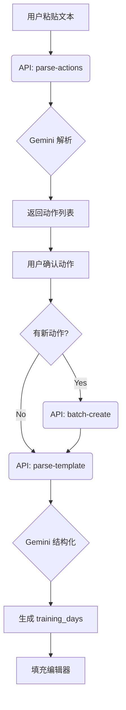

# 学员自建计划体系技术实现总结

> **文档版本**: 1.0 **生成日期**: 2025-12-29 **适用范围**: CoachLink
> 学员端自建计划功能模块

## 1. 体系概述

为了满足学员自主训练的需求，平台从纯粹的"教练分配计划"模式升级为"教练分配 +
学员自建"双轨模式。本体系包含三个核心模块：

1. **个人动作库**：学员建立属于自己的动作储备。
2. **自建计划管理**：学员创建、编辑、保存自己的训练计划。
3. **AI 智能导入**：通过自然语言快速从文本生成计划。

---

## 2. 核心模块详解

### 2.1 模块一：个人动作库 (Student Action Library)

学员拥有独立的动作库，与教练动作库（Coach Actions）完全隔离，数据私有。

#### 数据库设计 (`student_actions`)

相比教练动作库，学员动作库设计更为精简：

- **主键**: `id` (uuid)
- **归属**: `user_id` (uuid) - _注意：使用 generic user_id 而非 student_id_
- **基础信息**: `name` (名称), `detail` (详情), `url` (视频链接)
- **属性**: `positions` (部位), `attrs` (组数/次数等属性)
- **差异点**: **不包含** `enable_auto_weight_compute` 和 `includes_body_weight`
  字段（学员自建计划通常直接指定负重，无需复杂的 RM 自动计算算法）。

#### 核心 API (`/api/student/action-lib/*`)

| API 路径         | 功能         | 备注                                     |
| ---------------- | ------------ | ---------------------------------------- |
| `/list-actions`  | 获取动作列表 | 支持分页、名称搜索                       |
| `/add-action`    | 单个添加     | 基础 CRUD                                |
| `/batch-create`  | **批量创建** | _本次新增_，用于 AI 导入时批量生成新动作 |
| `/update-action` | 更新动作     |                                          |
| `/delete-action` | 删除动作     |                                          |

#### 前端实现

- 入口：`我的` -> `动作库`
- 组件：复用了通用的动作列表 UI，但数据源指向学员 API。

---

### 2.2 模块二：自建计划管理 (Student Plan Management)

学员可以创建并保存常用的训练计划模板，随后将其应用到具体的训练日期中。

#### 数据库设计 (`student_plan_favorites`)

用于存储学员的计划模板（不同于执行中的计划实例）：

- **主键**: `id` (uuid)
- **归属**: `user_id` (uuid)
- **核心数据**: `training_days` (jsonb) -
  存储完整的训练日结构（动作、组数、次数、负重等）
- **元数据**: `name`, `description`

#### 核心 API (`/api/student/plan-lib/*`)

| API 路径           | 功能             | 备注                                      |
| ------------------ | ---------------- | ----------------------------------------- |
| `/list-favorites`  | 获取常用计划列表 |                                           |
| `/save-favorite`   | 保存/更新计划    | 将编辑器状态保存为 template               |
| `/get-favorite`    | 获取详情         |                                           |
| `/delete-favorite` | 删除计划         |                                           |
| `/parse-actions`   | **动作解析**     | _本次新增_，AI 辅助接口                   |
| `/parse-template`  | **模板解析**     | _本次新增_，AI 辅助接口（无教练权限检查） |

#### 前端实现 (`/me/plan-lib/*`)

- **编辑器复用**: 核心编辑器组件 `CoachLinkPlanEditor` 经过重构，支持 `readOnly`
  和 `onChange` 模式，同时服务于教练端和学员端。
- **状态管理**: 页面级 State 管理 `training_days` 数据，保存时序列化为 JSON。

---

### 2.3 模块三：AI 智能导入 (Smart Import)

允许学员粘贴自由文本（如微信聊天记录、笔记），AI 自动识别动作并生成计划结构。

#### 流程图

#### 关键技术点

1. **两阶段解析**:
   - 第一阶段只识别动作，确保动作 ID 匹配或创建。
   - 第二阶段基于确定的动作 ID 解析组次数、负重和休息时间。
2. **模糊匹配**: 利用 AI 对比文本中的动作名与 `student_actions`
   库，实现智能去重。
3. **权限适配**:
   - 专门创建了无需教练权限的 `/api/student/plan-lib/parse-template` 接口。
   - 修正了数据库字段查询（`student_id` -> `user_id`）。

---

## 3. 总结

学员自建计划体系通过以上三个模块的协同，实现了从**基础数据积累**（动作库）到**核心业务流**（计划管理），再到**效率工具**（AI
导入）的完整闭环。这不仅减轻了教练的排课压力，也极大提升了高阶学员的使用体验。
