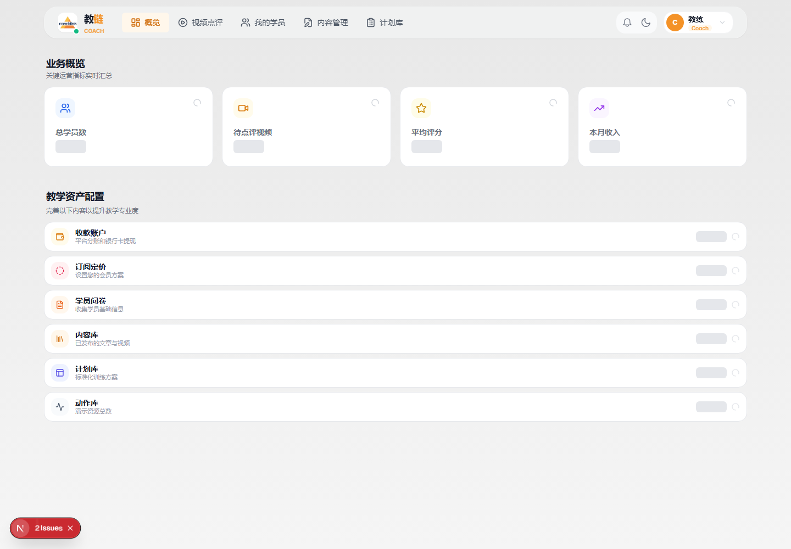
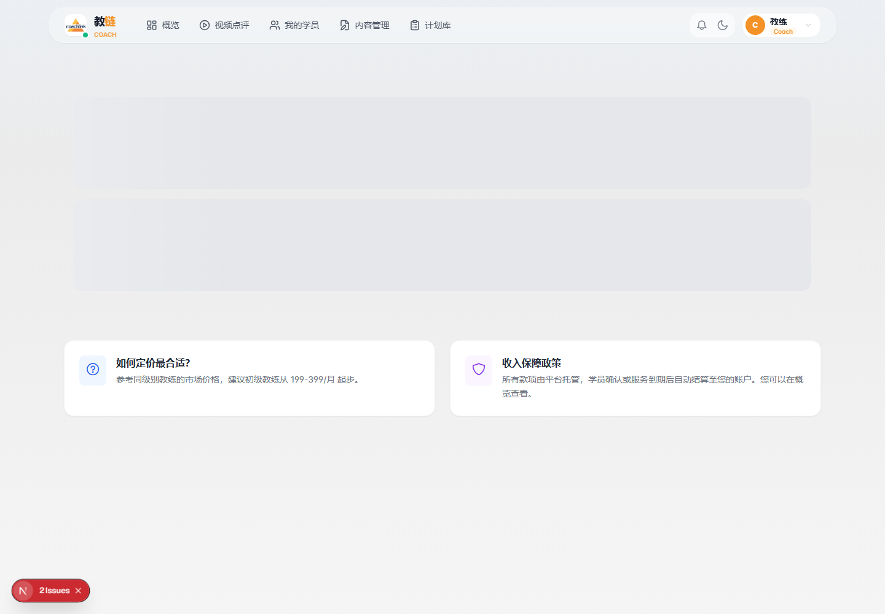
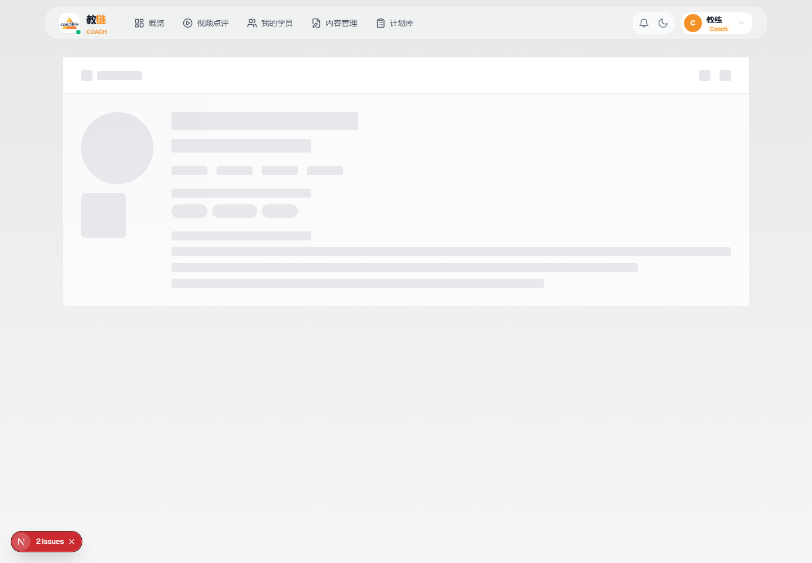
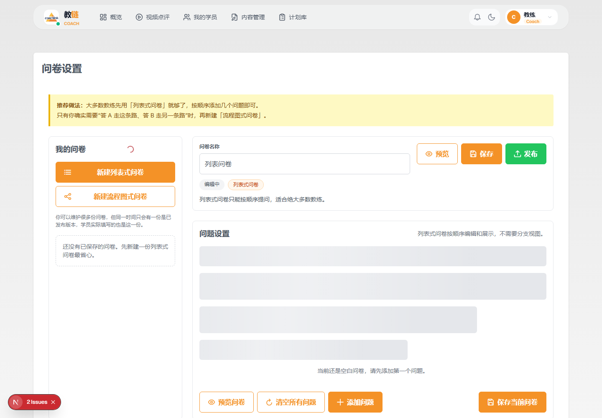
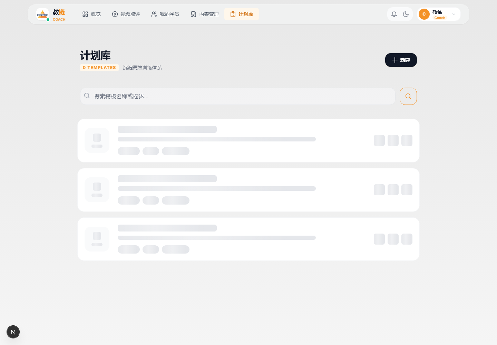
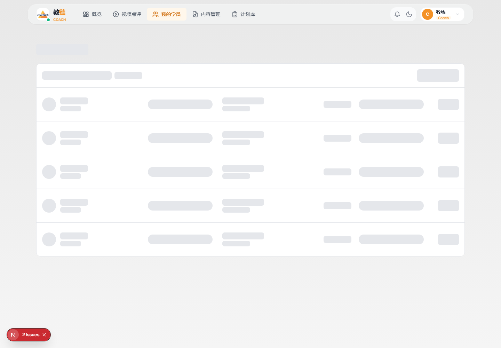

# 教练开始收学员操作教程

适用对象：已经通过教练审核、准备正式收学员的教练。

> 截图说明：以下产品截图使用临时测试教练账号生成，不包含真实教练或真实学员隐私数据。实际页面会根据你的收款账户、套餐、问卷、模板和学员情况显示不同内容。

## 目标

教练完成下面 6 件事后，学员就可以从教练主页完成了解、选择服务、填写问卷、支付订阅，系统会把学员同步到教练端「我的学员」里。

教练端首页会显示当前业务概览和待配置项目。第一次开始收学员前，优先把「收款账户」「订阅定价」「学员问卷」「计划库」这几项补齐。

## 1. 先确认收款与服务套餐

进入 Web 教练端：

- `教练端 / 订阅设置`
- 检查是否已经完成收款账户绑定
- 设置可售卖的服务套餐：名称、周期、价格、服务说明
- 保存后检查学员侧是否能看到对应套餐

建议套餐不要一开始写得太复杂。先保留 1-2 个主套餐，例如：

- 入门评估 + 4 周计划
- 进阶跟练 + 8 周计划

订阅设置页是学员购买服务前最关键的一步。这里要确认收款账户状态，并配置学员能选择的服务套餐、周期和价格。

## 2. 完善教练主页

进入：

- `教练端 / 我的主页` 或教练资料编辑入口

优先补齐这些内容：

- 头像、教练名称、头衔
- 擅长方向
- 适合的学员类型
- 训练理念
- 过往案例、证书、比赛或教学证明材料

主页不是简历堆砌，重点是让学员快速判断：

- 这个教练擅长什么
- 是否适合我
- 购买后会得到什么服务

教练主页是你对外展示和收学员的入口。学员通常会先看你的介绍、擅长方向、服务说明，再决定是否订阅。

## 3. 发布学员问卷

进入：

- `教练端 / 学员问卷`

问卷决定系统给你收集哪些学员信息，也会影响后续 AI 计划生成和你手动排课的效率。

建议至少包含：

- 训练目标
- 训练经验
- 每周可训练次数
- 重点动作或专项
- 伤病、疼痛、禁忌动作
- 当前能力数据，例如 1RM、最大次数、体重

完成后要发布为当前可用问卷。不要只保存草稿。

问卷建议做成顺序式问题。学员提交问卷后，这些信息会进入订阅和计划生成链路，后续你在「我的学员」里也能查看。

## 4. 准备计划模板和动作库

进入：

- `教练端 / 计划库`
- `教练端 / 动作库`

建议先准备 2-3 个可复用模板：

- 新手基础模板
- 专项提升模板
- 高阶或个性化模板

动作库里优先放你常用、真正会反复安排的动作。每个动作尽量补齐：

- 动作名称
- 动作说明
- 演示视频或链接
- 主要训练部位
- 是否参与自动重量计算

这样学员付款后，系统更容易自动匹配模板，你也更容易二次调整。

计划库是教练的核心资产。你可以先准备通用模板，再按具体学员问卷和训练反馈做调整。

## 5. 把教练主页发给学员

完成套餐、主页、问卷后，可以把自己的教练主页链接发给潜在学员。

推荐发给学员时说明三点：

- 先看主页和服务套餐
- 选择适合的周期并提交问卷
- 付款后等待你确认或系统自动分配计划

推荐话术：

> 这是我的 CoachLink 教练主页。你可以先看服务内容，选择适合的周期，提交训练问卷。问卷越完整，我后面给你做计划越准确。

## 6. 新学员进来后怎么处理

进入：

- `教练端 / 我的学员`

如果学员已通过平台支付，系统会自动确认订阅。

如果是需要你确认的订单，要及时处理「待支付确认」。

学员进入后，重点看：

- 学员问卷
- 订阅周期
- 当前计划状态
- 是否已经自动匹配计划
- 是否需要你手动创建或修改计划

建议当天完成首次处理，不要让新学员等太久。

「我的学员」是后续服务主工作区。新学员进入后，先看订阅状态和问卷，再决定是否自动匹配模板、手动创建计划，或联系学员补充信息。

## 日常运营建议

- 每天看一次「我的学员」
- 每周检查一次未完成训练、反馈、视频审核
- 收到新订阅后当天处理
- 有高风险疼痛、伤病反馈时，不要自动套模板，先人工判断
- 老学员续费前，提前准备下一阶段计划或调整方向

## 常见问题

### 已通过教练审核，但学员不能购买怎么办？

优先检查：

- 收款账户是否开通
- 订阅套餐是否已保存
- 教练主页是否正常展示套餐

### 学员填了问卷，但没有自动生成计划怎么办？

优先检查：

- 是否有已发布问卷
- 是否有可匹配的计划模板
- 模板训练天数和学员每周训练频次是否匹配
- 自动化设置是否关闭

### 我还没有模板，能不能先收学员？

可以，但不推荐。至少准备一个基础模板，否则每个新学员都要从零开始创建计划，响应速度会很慢。

## 给教练的简短提醒文案

你已经具备正式收学员资格。请尽快完成订阅套餐、学员问卷、计划模板和教练主页配置，然后把你的教练主页发给潜在学员。学员提交问卷并完成订阅后，会进入「我的学员」，你可以在那里查看问卷、确认订单、发放或调整训练计划。
