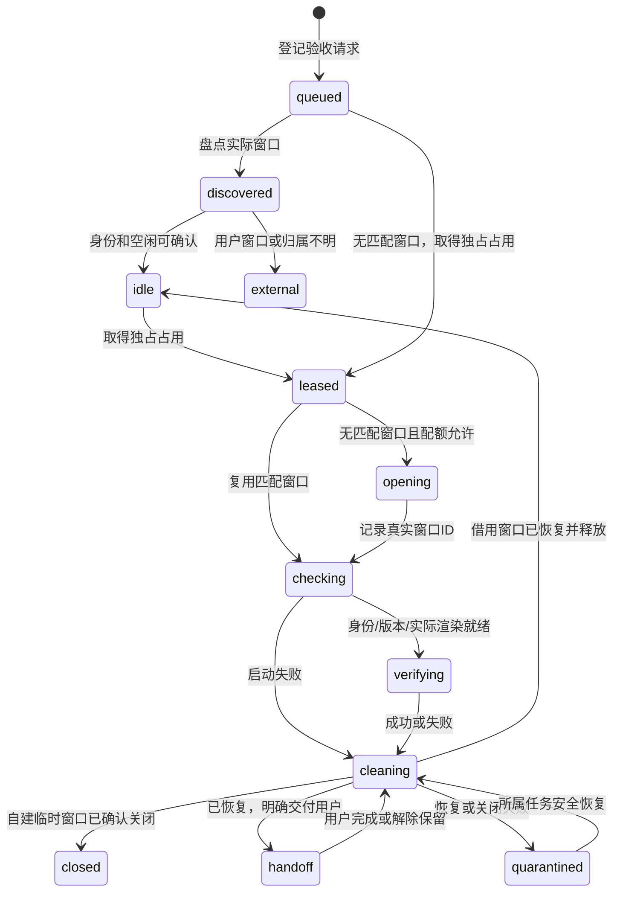

# 自动验收会话管理系统设计

日期：2026-10-06（Asia/Tokyo）。范围：先治理 CoachLink 微信开发者工具，接口预留 Web/移动端适配。本文与两份 AGENTS.md 规则已落盘；下述可执行管理器、状态页与自动回收尚未实现，不把设计当运行成果。

## 要解决的具体问题

用户看到七八个甚至更多微信开发者工具任务栏窗口，无法判断哪个是当前项目、哪个正在验收、哪个已经闲置。现有验证脚本通常 disconnect 或恢复 mock/storage，但不关闭项目窗口。不同对话还会同时切页面和重建共享 dist，导致截图来自错误页面、app.json 在清理重建期间消失、模拟器重载和自动化超时。

把注意事项只放在一个可选 skill 中无法保证每个代理执行。采用三层：AGENTS.md 规定统一入口；机器上共享的管理器执行互斥、复用和生命周期；状态表向用户展示真实归属。现有 weapp-devtools 与 port-manager 继续作为工具，不另建一个重复操作说明的 skill。

## 约定与数量限制

- 一个对话是验收请求的发起者，不自动获得一个新窗口。
- 逻辑项目由开发工具种类与 AppID识别；实际项目目录、构建目录、版本分别记录。同一个 AppID 的多个 acceptance 目录属于同一逻辑小程序。后续 Web 使用明确的项目身份，而非复用小程序键。
- 每个逻辑项目默认至多一个 AI 工作窗口；最多另保留一个已移交用户的窗口。所有同 AppID 的自动操作仍串行。全机 AI 工作窗口同时打开的默认上限为两个，供不同项目使用，待用户验收窗口单独明确列出且受各项目上限约束。
- 用户自行打开的窗口和迁移时发现的历史窗口先标记为外部资源，不因超过配额自动关闭；复用必须确认空闲和匹配，不能影响用户手动操作。
- 第一个任务结束后窗口应消失或明确转为待用户验收，不能变成没有用途的永久窗口。
- 一个项目已有handoff窗口时，第二次交付先与该保留用途协调；不能每个对话都用“待用户验收”绕过窗口上限。保留过期仅提示待处理，不据此自动关闭用户正在验收的窗口。

## 组成

| 部分 | 职责 | 不承担的职责 |
| --- | --- | --- |
| 根/小程序 AGENTS.md | 强制所有对话使用统一入口；规定占用、数量和回收 | 不声称靠文档已实现互斥 |
| 共享 session manager | 原子登记、排队、窗口复用、归属核验、生命周期、故障回收 | 不改业务账号、DB或发布版本 |
| DevTools adapter | 通过已验证的官方API/CLI盘点、开窗、就绪检查、关闭指定窗口 | 不按进程名强杀整个开发者工具 |
| build adapter | 锁输出目录，完整构建后交付固定版本，协调正在使用该输出的窗口 | 不改变运行时配置来源 |
| 用户状态表 | 显示真实窗口、占用任务、用途、版本及保留原因；聚焦指定窗口 | 不自己生成另一份项目窗口 |
| 现有验收脚本 | 在已取得占用的会话内导航、交互、截图和恢复测试状态 | 不再自行调用 open/auto 绕过管理器 |

机器共享状态建议位于 `%LOCALAPPDATA%/CoachLink/verification-manager/`，通过统一配置解析，不在每个对话或临时 checkout 内各建一份。其他项目若接入同一管理器即可共享全机配额；本次不修改 food_link 仓库或用户全局 Codex 指令。

## 登记的数据

每个会话最少记录：

- sessionId、逻辑项目ID、规范化绝对项目路径、实际构建目录、AppID、工具类型。
- 创建者任务ID、当前占用任务ID、可读用途、创建/心跳时间、操作期限、占用令牌。
- 窗口ID、后台返回的项目身份、自动化端口、关联进程ID与启动时间；进程ID只用于判断所属子任务，不作为任意关闭依据。
- 生命周期状态、createdByManager或borrowed、用户移交与保留原因。
- 固定构建指纹、最后页面、就绪证据、报告与截图路径、失败原因、清理结果。
- 需要恢复的测试状态仅在会话内安全保存；公开状态表不得展示JWT、账号缓存、mock响应中的个人数据。

登记必须原子更新。路径先解析真实绝对路径，在Windows上统一大小写/分隔符；符号链接别名指向同一输出时不得绕过构建锁。注册表损坏时阻止新建并报告，不能静默当成空表继续开窗。

## 两类占用，解决两种干扰

**交互占用**：同一逻辑小程序一次只有一个任务操作。锁覆盖导航、截图、mock、storage及恢复，贯穿整个验收，而不是每个命令单独取锁。后来的对话排队，显示正在被哪个任务用于什么检查。

**构建占用**：按实际输出目录协调。某份输出正在被窗口验收时，禁止清空、覆盖、重建或切其配置；构建任务要等待或输出到新的独立目录。新目录必须在Taro编译及所有后处理完成后才标记完整，再交给窗口。独立目录使用固定版本指纹，验收途中不修改。

独立路径/端口只减少部分干扰，不能证明相同 AppID 的登录态、缓存、mock和工具内部上下文完全隔离。因此第一版保守地串行相同 AppID，不承诺同小程序多窗口并行。

锁使用机器上原子的独占创建或操作系统等价机制，不采用“先读JSON再写占用”的竞争实现。多锁按固定顺序获取；任务不能持有交互锁无限等待由另一个任务持有的构建锁。等待取消或超时必须移除自己的排队记录。

## 生命周期

`closed` 必须由工具重新盘点确认。CLI退出、disconnect返回或关闭请求返回不能独立证明窗口已经消失。`quarantined` 不得直接复用或隐藏，需在状态表列出清理失败原因。

## 一次验收的流程

1. 读取项目配置、AppID与固定构建指纹，登记任务用途，核对共享注册表与工具的实际窗口。
2. 按逻辑项目申请独占交互占用，协调所用构建目录。已有活跃任务则排队，不切页、不新开同项目窗口规避占用。
3. 查找匹配版本且可用的窗口。没有匹配窗口才在配额内创建，及时登记工具返回的窗口ID。开窗结果不明时先再盘点，不能盲重试制造重复窗口。
4. 用官方工具核对项目身份、AppID、端口与当前页面，并取得对应构建的实际渲染证据。连接成功不等于页面ready；未就绪不得进入业务验收。
5. 跑现有验收脚本。证据记录sessionId、任务、包指纹和路由，避免拿历史截图当当前包通过。
6. 在finally里恢复mock/合成storage，写报告，断开连接。
7. 只关闭本管理器创建的临时窗口；借用窗口释放占用；交付用户的窗口改为handoff并登记用途、版本与保留原因。
8. 确认关闭/恢复结果后释放占用。恢复失败先隔离资源，再释放调度锁让其他任务可诊断，不能交给下一个验收任务。

## 失败和崩溃

- 所有步骤有有限期限；连接失败最多对同一窗口尝试一次重连，仍失败即收集可获得的第一条错误、结束并收尾。不能无限打开/清缓存/重启。
- 正常异常与取消走finally。独立监督器持久记录租约并检查任务/子进程是否存活，处理代理被中断而没有执行finally的情况。
- 心跳过期仅表示需要核查，不等于允许关窗；工具调用耗时或用户正在操作可能造成误判。须再核验占用任务、进程启动时间、窗口归属及用户移交状态。
- 只有原占用令牌可以结束自己的租约，防止迟到的旧任务释放新的任务占用。
- 关闭前再核验真实窗口身份，避免窗口ID复用误关。存在未保存内容、确认弹窗或其他活跃任务时停止自动关闭，状态改为需处理；禁止强杀整个微信开发者工具进程。
- 自动化清理不能恢复或验证测试状态时，资源进入quarantined；不自动清用户全部storage，不拿真实业务账号反复重置。
- 回收GUI窗口不删除项目、dist、node_modules或截图。构建产物清理是另一项明确的保留策略，按仓库reparse point规则独立处理。

## 用户看到的状态

状态表至少包含“项目 / 用途 / 谁在使用 / 状态 / 版本 / 为什么保留”。名称建议为“CoachLink · 登录取消 · AI验证”或“CoachLink · 器材筛选 · 待你验收”。能否将真实窗口标题可靠设置需由adapter验证；不能依赖标题作为身份。

以下仅是展示格式，不是当前窗口的实际清单：

| 项目 | 用途 | 使用者 | 状态 | 保留原因 |
| --- | --- | --- | --- | --- |
| CoachLink | 登录取消 | 会话A | 验证中 | 工作窗口 |
| CoachLink | 器材筛选 | 用户 | 待用户验收 | 固定包已交付 |
| FoodLink | — | 未确认 | 历史窗口 | 等待核对，不自动关 |

第一版状态表可以是终端/Markdown报告，不必先开新的网页或开发服务器。后续轻量面板提供“聚焦这个窗口”“保留给我”“结束并清理”，必须仍调用同一管理器，不能自己绕过登记开窗。

拟定内部命令为 status、run、handoff、release、doctor、cleanup；这些是待实现接口，不是当前可运行命令。run包住现有验证脚本，status盘点，doctor报告冲突与未回收资源，cleanup仅处理可证明由管理器所有且无活跃任务的窗口。

## 当前七八个旧窗口的迁移

1. 先通过官方项目窗口API和必要的只读Windows窗口清单盘点。分清真实项目窗口、启动器、调试辅助窗口和空白窗口，不能把每个缩略图都算一份项目。
2. 关联完整项目路径、AppID、构建目录、窗口ID和能确认的任务证据。新管理器无法推断所有历史归属。
3. 生成候选表：正在使用 / 待用户验收 / 已确认闲置且本任务创建 / 归属不明。旧窗口不批量认领。
4. 只按确切授权及归属证据关闭闲置窗口；用户窗口、其他项目及归属不明的窗口保留待确认。停止重试产生的新窗口后，逐项收敛旧窗口数量。
5. 之后所有新验收脚本强制从统一入口进入。现有进行中的对话不会因为AGENTS.md被修改立刻获得新运行逻辑，需在下次操作前重新读取并接入。

## 实现顺序与验收标准

**阶段1：调度核心。** 机器共享注册表、原子占用、排队、status；用隔离文件系统/伪造adapter验证竞态、取消、占用令牌和损坏记录。先防止新增混乱。

**阶段2：工具适配与生命周期。** 核对本机实际支持的盘点/开窗/关窗工具；不能臆造官方命令名。先接入现有weapp验证脚本，验证工作窗口回收、borrowed保留、handoff保留与清理失败隔离。

**阶段3：构建协调与故障监督。** 构建完整标记、版本指纹、输出锁与崩溃检测；迁移当前旧窗口，必要时再做可点击的状态面板。暂不安装Windows后台服务或创建定时自动化。

必须满足：

- 同时发起三个同项目验收，仅一个进入交互，另外两个排队，不产生三个窗口。
- 同项目连续验收十次，未移交用户时窗口数量不累计；失败/超时/取消也能收尾。
- 不同项目可以在全机上限内独立验收，端口不抢用；同AppID不同产物仍串行。
- 验收正在使用的输出目录不能被另一任务清空重写；独立构建未完整时不能打开。
- 用户原有与handoff窗口不被自动关闭；旧任务令牌、过期窗口ID、伪造归属不能关闭当前资源。
- 恢复mock/storage失败时资源隔离，报告准确，无业务数据库写入或登录凭据泄露。
- 页面就绪及截图绑定当前版本；退出命令后实际窗口盘点符合清理结果。

本轮完成的是设计与代理规则，不启动/关闭项目窗口、不上传/提审/发布，不宣称以上系统验收用例已经运行。
