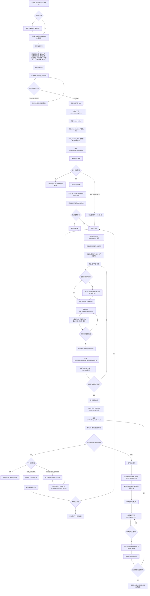
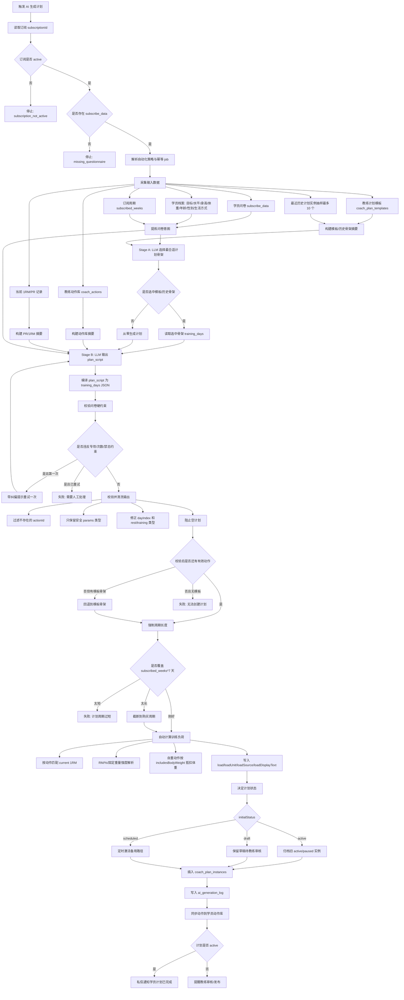

# CoachLink 学员问卷到计划完成、续费等待与 AI 算法流程

> 目的：用于向产品、运营、教练和研发解释 CoachLink 的核心教练服务闭环。本文按当前系统实现口径整理：学员填写教练问卷并购买服务后，系统自动生成首个计划；学员执行并完成阶段后，系统根据剩余额度生成下一阶段计划或进入续费等待。

## 1. 核心口径

1. 订阅不是按自然日硬过期，而是按训练日 credits 消耗。
2. `coach_subscriptions.subscribed_weeks` 表示学员购买的服务周期，系统用它推导可执行训练日额度。
3. `coach_subscriptions.start_date` 通常不是付款时间，而是第一次真实开始训练时写入。
4. `coach_subscriptions.end_date` 更偏向预计完成日展示，不是 active 订阅的硬阻断条件。
5. 首个计划默认自动发布；反馈调整默认生成草稿提醒教练；下一阶段默认生成草稿提醒教练。
6. 阶段完成但剩余额度不足时，不会继续自动生成下一阶段，系统进入续费等待。
7. 续费成功后会增加 subscribed weeks，并重新触发续费检查；如果存在已完成阶段，则继续尝试生成下一阶段。

## 2. 业务全链路流程图



## 3. 业务状态详细说明

### 3.1 问卷阶段

学员不是只点一个购买按钮，而是先把教练需要的执教上下文交给系统。问卷答案会成为首个计划的核心输入，并保存为订阅快照 `coach_subscriptions.subscribe_data`。这份快照比普通问卷历史更重要，因为它代表“本次购买服务时的交付依据”。

问卷中建议明确收集：

1. 训练目标：增肌、力量、街健专项、减脂、恢复训练、动作突破等。
2. 当前水平：训练年龄、近期训练频率、可完成动作、当前瓶颈。
3. 每周训练次数：AI 生成完整周历时必须遵守这个硬约束。
4. 可用器械和场地：家庭、健身房、单杠双杠、自由重量等。
5. 时间限制：单次训练可用时长、固定休息日。
6. 伤病/禁忌：疼痛、旧伤、不能做的动作、医生建议等，这是高优先级安全约束。
7. 身体数据：体重、身高、年龄、性别等，用于自重动作和负荷建议。
8. 1RM/RM 或动作能力：用于自动算重量；没有时用动作库参考值或问卷兜底。
9. 备注/特殊偏好：想优先突破的专项、讨厌/喜欢的动作、训练风格。

### 3.2 支付与订阅阶段

订单先承载支付事实，订阅再承载服务事实。

1. 学员提交问卷和购买选择后，系统创建订阅订单。
2. 订单进入 `pending_payment`。
3. 平台支付成功后，订单变为 `paid`。
4. 系统创建或更新 `coach_subscriptions`：
   - `status=active`
   - `subscribe_data=问卷快照`
   - `subscribed_weeks=购买周期`
   - `start_date=null`，等待第一次真实训练开始
   - `end_date=null` 或后续动态刷新为预计完成日
5. 首单成功后触发 `onSubscriptionActivated(subscriptionId)`。
6. 续费成功后触发 `onRenewalPaid(subscriptionId)`。

### 3.3 首个计划生成阶段

系统会先解析自动化策略，策略来源优先级是：

1. 平台默认策略。
2. 教练全局策略。
3. 单个学员/订阅覆盖策略。

当前默认策略：

| 自动化项 | 默认值 | 含义 |
|---|---|---|
| 首个计划 | `auto_publish` | 支付并激活订阅后，系统直接生成并发布计划 |
| 训练反馈调整 | `draft_notify` | 学员反馈后，系统生成调整草稿并提醒教练 |
| 下一阶段 | `draft_notify` | 阶段完成且额度足够时，系统生成下一阶段草稿并提醒教练 |
| 风险保护 | `strict` | 疼痛/伤病/异常反馈必须教练复核 |

首个计划生成有几个保护：

1. 没有 active 订阅，不生成计划。
2. 没有问卷快照，不生成计划。
3. 同一个订阅已经有计划实例，不重复生成。
4. 生成结果没有有效训练动作，阻止创建空计划。
5. 如果生成 active 计划，会先归档同订阅下旧的 active/paused 实例。
6. 生成完成后会同步动作到学员动作库，保证执行页能识别动作。
7. active 计划会私信通知学员进入今日训练。

### 3.4 训练执行阶段

学员每次训练对应一条 `plan_instance_executions`，它是系统判断进度和消耗 credits 的核心证据。

执行过程中会记录：

1. `instance_id`：属于哪个计划实例。
2. `day_index`：计划中的第几天。
3. `status`：`in_progress`、`completed`、`abandoned` 等。
4. `action_executions`：动作、组、计划重量、实际重量、次数、完成状态。
5. `completed_sets` / `total_sets`：完成进度。
6. `completed_at`：完成时间。
7. 视频、备注、反馈等扩展记录。

完成当天训练后：

1. execution 写入 `status=completed`。
2. completed 的训练日计入 usedCredits。
3. 系统刷新订阅预计完成日。
4. 如果所有训练日都完成，计划实例进入完成阶段。

### 3.5 计划完成与续费等待

计划完成后，系统触发下一阶段自动化：

1. 读取当前订阅和自动化策略。
2. 检查订阅是否还有剩余额度。
3. 如果还有额度：
   - 默认生成下一阶段草稿并提醒教练。
   - 如果教练配置 `auto_publish_if_credits`，则直接发布下一阶段。
4. 如果没有额度：
   - 不生成下一阶段。
   - 自动化 job 标记为 skipped，原因是 `insufficient_entitlement`。
   - 系统消息提醒教练：学员阶段已完成，但订阅额度不足。
   - 学员端进入“当前阶段已完成/等待续费”的状态。

续费后：

1. 续费订单支付成功。
2. `subscribed_weeks` 增加。
3. 订阅保持或恢复为 `active`。
4. 系统触发 `onRenewalPaid`。
5. 如果存在最近 completed 阶段，重新走下一阶段生成逻辑。
6. 如果额度已经足够，则生成下一阶段草稿或自动发布。

## 4. AI 计划生成算法流程图



## 5. AI 算法详细说明

### 5.1 算法输入

AI 不是只拿一段问卷文本生成计划。系统会组合以下上下文：

1. 订阅上下文：
   - `subscriptionId`
   - `studentId`
   - `coachId`
   - `subscribed_weeks`
   - `subscribe_data`
2. 学员档案：
   - 目标
   - 训练水平
   - 身高、体重、年龄、性别
   - 生活方式
   - 运动卡片/历史偏好
3. 问卷答案：
   - 标签类目标
   - 每周训练次数
   - RM/1RM 输入
   - 伤病禁忌
   - 器械和时间限制
4. 当前 1RM/PR：
   - 个人 PR 历史
   - 学员动作库 reference 1RM
   - 问卷 RM 兜底
5. 教练动作库：
   - 动作 ID
   - 动作名称
   - 类型
   - 描述
   - 是否支持自动算重量
   - 是否包含自重
6. 教练计划资产：
   - 计划模板
   - 最近历史学员计划抽样
   - 执行须知
   - 模板标签、类型、适合人群

### 5.2 Stage A：选择计划骨架

系统先让 LLM 做一件较窄的事：从候选模板/历史计划中选择最合适的骨架。

Stage A 的目标不是直接生成完整计划，而是降低自由生成风险：

1. 优先复用教练已有模板。
2. 没有完全匹配时，选择最接近且最容易改造的骨架。
3. 只有没有任何可借用骨架时，才允许从零生成。
4. 如果问卷明确只练某个专项，优先选择单专项骨架，避免错选组合模板。
5. 输出结构化 JSON：
   - `template_id`
   - `reasoning`
   - `confidence`

这一步会写入 `ai_generation_log.stageA`，方便教练和研发回溯 AI 为什么选这个模板。

### 5.3 Stage B：个性化生成 plan_script

Stage B 不是直接让模型写数据库 JSON，而是让模型输出紧凑计划脚本 `plan_script`。这样做有几个好处：

1. token 更少。
2. 人类教练可读。
3. 后端可以用确定性编译器转成 `training_days`。
4. 可以严格检查动作名称和 actionId。
5. 避免模型随手编造复杂 JSON 字段。

`plan_script` 的格式示例：

```text
W1
D1
深蹲 5x5 @5rm r180
卧推 4x6 @70% r150
D2 off #恢复或轻有氧
```

Stage B 的硬规则：

1. 只能使用教练动作库或模板骨架中存在的动作。
2. 必须覆盖完整购买周期：`subscribed_weeks * 7` 天。
3. 每周训练次数必须符合问卷。
4. 必须包含休息日，而不是只输出训练日。
5. 必须尊重伤病、禁忌动作、器械限制。
6. 问卷明确单专项时，不能保留冲突专项主项。
7. 至少包含一个有效训练日。
8. 输出必须是 JSON，字段为 `plan_script`、`reasoning`、`changes_summary`。

### 5.4 编译与硬约束校验

模型输出后，系统不会直接入库，而是执行确定性校验：

1. 用 `parsePlanScript` 把脚本编译成 `training_days`。
2. 用问卷意图校验器检查：
   - 是否违反单专项偏好。
   - 是否违反禁忌动作。
   - 是否违反每周次数。
3. 如果第一次违反硬约束，系统会带着纠偏提示让模型重试一次。
4. 如果重试后仍违反，直接失败并交给人工处理。

### 5.5 输出清洗

编译后还会清洗一遍：

1. 不存在的 actionId 会被跳过。
2. 非对象 day 会被跳过。
3. rest/training 类型会规范化。
4. `dayIndex` 会重新按顺序修正。
5. params 只允许 string/number/boolean/null 这类安全值。
6. 清洗后为空计划会被阻止。
7. 如果 AI 输出清洗后没有动作，但 Stage A 选中了有效模板，系统会回退到模板骨架。

### 5.6 周期长度保护

系统会强制计划覆盖购买周期：

1. 如果购买 4 周，最终计划必须至少有 28 天。
2. 如果 AI 只生成 14 天，直接失败。
3. 如果 AI 生成 35 天，会截断成 28 天，并重新修正 dayIndex。
4. 这样可以保证计划交付与购买周期一致。

### 5.7 负荷和重量计算

计划动作里的强度可能是：

1. 固定重量：例如 `@20kg`
2. 百分比：例如 `@75%`
3. RM 强度：例如 `@5rm`
4. 旧字段：例如 params 里的 `强度`

系统会读取学员当前 1RM：

1. 先做权限校验，确认教练有权读取该学员数据。
2. 读取个人 PR 历史。
3. 读取学员动作库 reference 1RM。
4. 读取当前 active 订阅里的问卷 RM 兜底。
5. 生成动作 ID、标准动作 ID、动作名多个索引，尽量避免旧问卷 key 对错动作。

对于支持自动计算的动作，系统会写回：

1. `load`
2. `loadUnit`
3. `loadSource`
4. `loadDisplayText`
5. `loadCalculated`

自重动作会额外考虑体重。简化公式是：

```text
推荐外部负重 = (1RM + α * 体重) / λ(目标次数) - α * 体重
```

其中：

1. `α=1` 表示动作包含自重，例如引体、臂屈伸、俯卧撑等。
2. `α=0` 表示普通外部负重动作。
3. `λ(目标次数)` 是 RM 次数对应的强度系数。

### 5.8 入库与通知

计划通过校验后，系统写入 `coach_plan_instances`：

1. `name`：通常是“某某的计划”。
2. `description`：AI 理由或模板描述。
3. `execution_notice`：继承模板执行须知。
4. `coach_subscription_id`
5. `coach_id`
6. `student_id`
7. `training_days`
8. `start_execution_day`
9. `status`
10. `ai_generation_log`

如果状态是 `active`：

1. 系统归档同一订阅下旧 active/paused 计划。
2. 同步教练动作到学员动作库。
3. 私信通知学员计划已制定完成。

如果状态是 `draft`：

1. 计划只给教练看。
2. 自动化 job 标记为 `needs_coach_review`。
3. 系统消息提醒教练审核发布。

## 6. 反馈调整算法

学员完成训练后可以提交反馈。反馈不是直接让 AI 重写整份计划，而是先走风险分类和安全补丁。

### 6.1 风险分类

高风险关键词包括：

1. 疼、痛、伤、拉伤、扭伤、刺痛、麻木。
2. 头晕、胸闷、恶心、肿、炎。
3. 无法完成、不能继续。
4. injury、pain、numb、dizzy、strain、sprain 等英文表达。

中风险关键词包括：

1. 太累、疲劳、恢复差、睡眠差。
2. 连续失败、压力大、不适。
3. fatigue、recovery、stress 等英文表达。

处理规则：

1. 高风险：只提醒教练，不自动改计划。
2. 中风险：倾向生成草稿，不直接自动应用。
3. 低风险：如果教练策略允许，可以小幅自动应用。

### 6.2 调整方向

系统会从反馈里判断方向：

1. 太轻、简单、不累、difficulty <= 2：小幅增加容量/次数。
2. 太重、太难、累、difficulty >= 4：降低容量。
3. 时间不够、太久、来不及：压缩训练量。
4. 其他：增加备注，提醒教练关注动作质量和主观疲劳。

### 6.3 修改边界

反馈调整只改未来训练：

1. 不改反馈当天及之前的训练日。
2. 不改 completed/in_progress/abandoned 的训练日。
3. 最多改动前几个未来动作项，避免大面积重写。
4. 高风险永远需要教练复核。
5. 默认策略下只生成草稿提醒，不自动应用。

## 7. 下一阶段与续费算法

### 7.1 阶段完成触发

计划实例被标记为 `completed` 后，系统触发 `onPlanProgressChanged`：

1. 读取计划实例。
2. 找到所属订阅。
3. 解析自动化策略。
4. 创建 `next_phase` 自动化 job。
5. 检查剩余 entitlement/credits。

### 7.2 有剩余额度

如果还有剩余额度：

1. 默认 `draft_notify`：生成下一阶段草稿并提醒教练。
2. 如果配置 `auto_publish_if_credits`：生成并自动发布下一阶段。
3. 自动发布时，上一阶段 completed 计划会归档为 `served_phase`，并按 `count_service` 计入服务交付。

### 7.3 没有剩余额度

如果没有剩余额度：

1. 不生成下一阶段。
2. 自动化 job 标记 skipped。
3. skipped 原因是 `insufficient_entitlement`。
4. 系统消息提醒教练引导学员续费。
5. 学员端进入阶段完成/续费等待。

### 7.4 续费后恢复

续费成功后：

1. 系统增加 `subscribed_weeks`。
2. 订阅保持 active。
3. 触发 `onRenewalPaid`。
4. 系统寻找最近 completed 计划。
5. 找到后重新走下一阶段逻辑。
6. 如果新增额度足够，生成草稿或自动发布。

## 8. 关键代码对应

| 模块 | 代码位置 |
|---|---|
| 订阅订单/确认/续费主逻辑 | `src/lib/subscriptionOrders.ts` |
| 兼容订阅创建 | `src/app/api/subscription/create-subscription/route.ts` |
| 续费接口 | `src/app/api/subscription/renew-subscription/route.ts` |
| 首计划自动化 | `src/lib/coachingAutomation/initialPlan.ts` |
| 下一阶段/续费自动化 | `src/lib/coachingAutomation/nextPhase.ts` |
| 自动化策略 | `src/lib/coachingAutomation/policy.ts` |
| AI 计划实例创建 | `src/app/api/plan-lib/create-ai-instance/service.ts` |
| 模板规则匹配/负荷填充 | `src/app/api/plan-lib/create-ai-instance/match.ts` |
| LLM 个性化计划服务 | `src/app/api/plan-lib/ai-personalize-plan/service.ts` |
| Stage A 选模板 | `src/app/api/plan-lib/ai-personalize-plan/select-template.ts` |
| Stage B 输出 plan_script | `src/app/api/plan-lib/ai-personalize-plan/personalize-plan.ts` |
| AI 输出校验 | `src/app/api/plan-lib/ai-personalize-plan/validate-output.ts` |
| 当前 1RM 聚合 | `src/app/api/student/get-current-1rm/route.ts` |
| 完成训练日 | `src/app/api/execution/finish/route.ts` |
| 完成计划实例 | `src/app/api/plan-lib/complete-instance/route.ts` |
| 反馈调整自动化 | `src/lib/coachingAutomation/feedback.ts` |
| 反馈补丁规则 | `src/lib/coachingAutomation/feedbackPatch.ts` |

