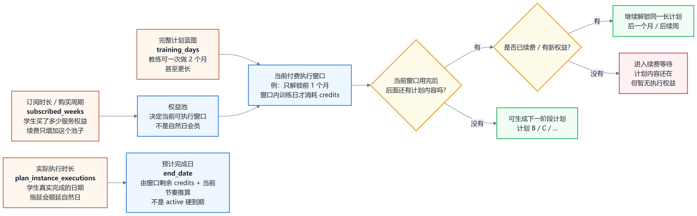
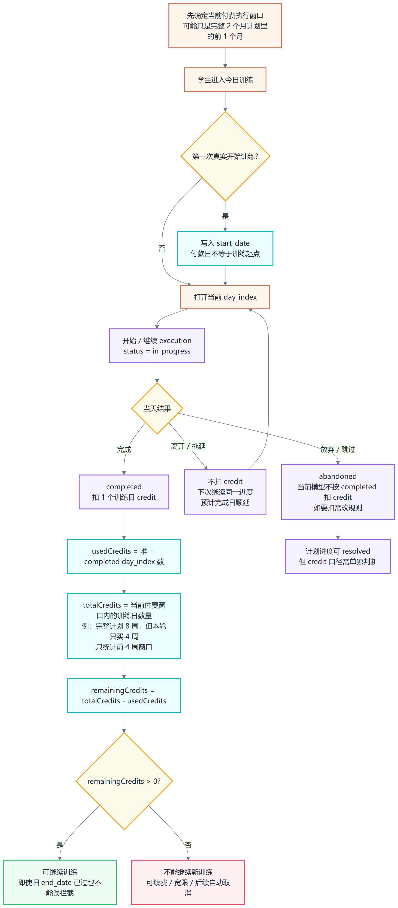
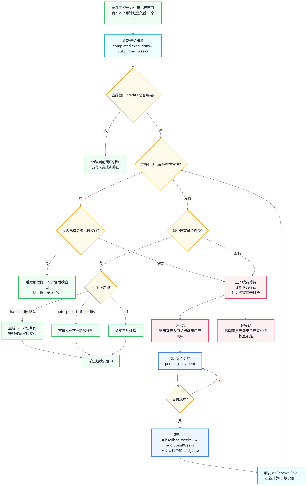
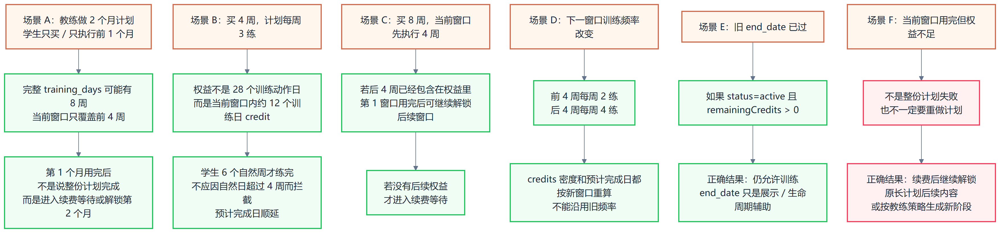

# CoachLink 学生执行计划解释图：可阅读拆分版

这版把原来的大图拆成 4 张小图，避免 PNG 缩放后看不清字。

## 1. 概念关系

核心：完整计划蓝图、当前付费执行窗口、实际执行时长、预计完成日是四件事。教练可以做两个月计划，学生当前只执行前一个月。

## 2. 执行与 Credits

核心：只统计当前付费窗口里的训练日 credits；完整计划后面的内容可以先存在，但不代表本轮都可执行。

## 3. 完成与续费等待

核心：当前付费窗口用完后，先看完整计划后面是否还有内容，再看是否有权益解锁；没有权益才进入续费等待。

## 4. 典型场景

核心：最容易讲错的是把“整份长计划”当成“本轮执行窗口”，或者把“当前窗口用完”说成“整份计划完成”。

## 直接打开预览

- HTML 预览页：`output/student-plan-execution-readable-preview.html`
- 单图 SVG：
  - `output/student-plan-execution-01-concepts.svg`
  - `output/student-plan-execution-02-credits.svg`
  - `output/student-plan-execution-03-renewal.svg`
  - `output/student-plan-execution-04-scenarios.svg`
