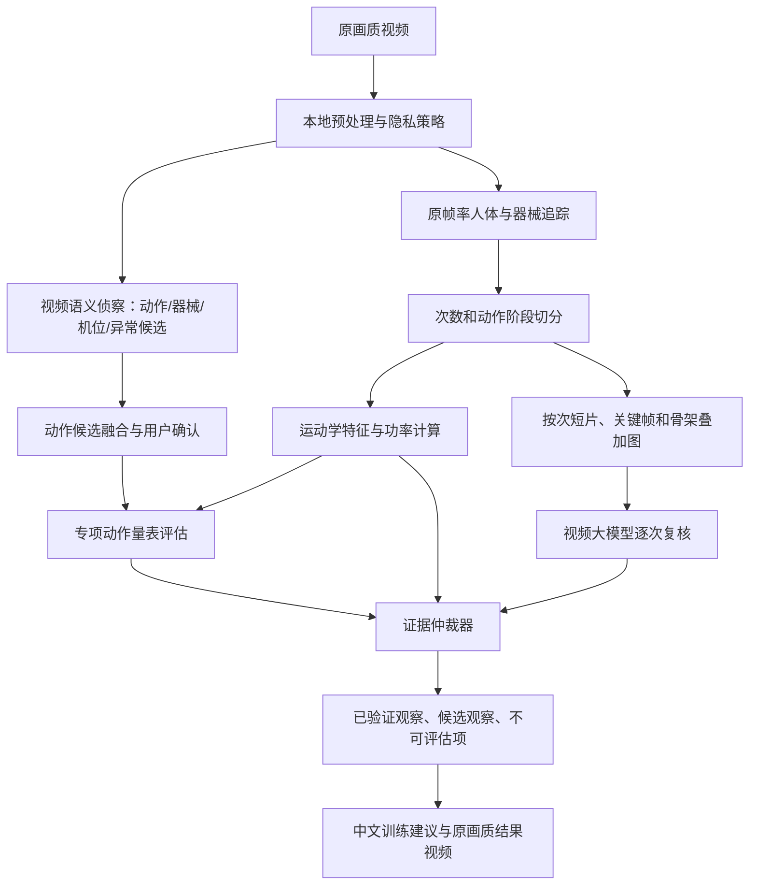

# 教链智能动作分析 V2：多模态证据融合架构

- 状态：设计确认中，尚未进入生产实现
- 日期：2026-08-09
- 范围：功率分析器升级、相对通用动作识别、动作质量评估与训练建议

## 1. 结论

视频多模态大模型必须进入智能动作分析主链路，但它不是关键点算法的替代品，也不能成为最终裁判。V2 采用三路互补：

1. **运动学通道**：原帧率人体/器械追踪，负责次数、阶段、角度、速度、位移、对称性和功率等可重复测量。
2. **视频语义通道**：视频多模态大模型负责开放动作识别、器械/环境/机位理解、动作变式识别、异常候选发现和跨次数的整体理解。
3. **动作知识通道**：版本化动作量表负责定义训练目标、可观察项、机位要求、错误代码、严重度和建议边界。

最终用户结论必须经过证据仲裁。大模型可以提出候选观察，不能凭语言流畅度覆盖可验证的运动学事实。

## 2. 为什么传统姿态算法仍然必要

视频大模型擅长回答“这是什么动作、使用了什么器械、整体看起来哪里不协调”，但以下任务仍应由原帧率计算机视觉完成：

- 30/60 FPS 下的次数和阶段边界；
- 关节角度及角速度；
- 左右关键点的逐帧对称性；
- 杠铃、身体重心或锚点轨迹；
- 位移、速度、功率和速度衰减；
- 同一视频重复分析时的稳定、可回归结果。

Gemini 官方视频接口支持视频、时间点和自定义 FPS，但默认采样约 1 FPS，官方也明确提醒快速动作可能丢失细节。因此它适合语义理解和复核，不适合单独计算双力臂转腕、深蹲触底、膝轨迹或峰值速度。

## 3. 视频大模型的核心价值

### 3.1 开放世界动作识别

传统分类器只能识别训练过的固定类别。视频大模型可以给出开放词表候选，例如：

- 负重引体、摆动引体、爆发引体；
- 高杠深蹲、低杠深蹲、前蹲、箱式深蹲；
- 双力臂、借力双力臂、慢速双力臂；
- 未收录的新动作及其可能所属动作家族。

闭集骨架分类器仍输出已支持动作的概率；视频大模型输出开放候选。两者一致时自动进入专项评估，不一致或低置信度时让用户确认。

### 3.2 场景和动作上下文理解

视频大模型负责识别传统关键点不容易表达的上下文：

- 自重、腰链、杠铃、弹力带、辅助器械；
- 正面、侧面、斜前方、斜后方及镜像自拍；
- 目标人物、多人干扰、遮挡和关键部位是否出画；
- 动作变式和训练目的的候选判断；
- 哪些评价从当前机位可观察，哪些不可观察。

负重重量、身高、体重和训练目标仍以用户资料、训练计划或手动确认为准。视觉模型只能给候选值，不能静默覆盖用户数据。

### 3.3 未知问题发现

专项规则只能发现已经定义的问题。视频大模型可以提出规则库之外的候选，例如“握距在后半组发生改变”“右脚在每次起身时重新调整”“过渡阶段出现异常停顿”。

这种候选默认不进入量化评分，只以 `candidate_observation` 保存。经过运动学复核或教练确认后，才能升级为正式错误代码，反向扩展动作量表。

### 3.4 建议组织与个性化解释

大模型可以综合动作目标、训练历史、当前负重、速度衰减和已验证观察，选择更合适的表达顺序与训练提示。它只能解释已提供的结构化证据，不得自行诊断肌肉无力、关节损伤或疼痛原因。

## 4. 推荐处理流水线



### 4.1 第一次模型调用：全片语义侦察

输入低频全片或均匀采样帧，输出：

- 动作 Top-K 和动作变式；
- 器械、负重形式和辅助方式；
- 机位、遮挡、人物数量和视频质量；
- 粗略次数；
- 需要精确算法验证的异常候选；
- 建议启用的动作量表。

这一阶段追求召回率，不直接生成最终评分。

### 4.2 原帧率运动学分析

在本地或专用 Motion Worker 上处理原始视频，保存完整关键点时序，而不是只保留单一纵向锚点：

- 2D 关键点、置信度和可见性；
- 可选的 2D 到 3D 提升结果及其不确定度；
- 人体、杠铃、单杠、杠铃片等目标轨迹；
- 次数和动作阶段；
- 角度、位移、速度、加速度、功率、对称性、稳定性和节奏。

### 4.3 第二次模型调用：逐次动作复核

不必再次发送整段长视频。每次动作只发送以下证据包：

- 该次动作的短片，建议按任务采样 5～10 FPS；
- 8～16 张带帧号/时间戳的关键帧；
- 一份骨架叠加图或轨迹图；
- 本次动作的结构化角度、速度和阶段数据；
- 当前动作量表中允许判断的问题清单；
- 明确要求模型只输出观察事实，不推断医学原因。

视频大模型此时更像第二位观察员，而不是从零看视频自由发挥。

## 5. 证据仲裁规则

所有输出分为四档：

| 状态 | 条件 | 用户展示方式 |
|---|---|---|
| `verified` | 运动学证据达到阈值，并与量表一致；大模型可同意或不参与 | 进入评分和正式建议 |
| `corroborated` | 运动学与视频大模型独立指向同一问题 | 进入评分，显示较高置信度 |
| `visual_only` | 视频大模型观察到，但关键点被遮挡或没有对应测量 | 仅作“可能存在”的观察，不扣分 |
| `abstained` | 证据冲突、机位不适合或置信度不足 | 明确显示无法可靠评估 |

冲突处理原则：

- 精确角度、次数、时间和功率发生冲突时，以通过质量门禁的运动学结果为准；
- 动作类型、器械、变式、环境和开放异常候选可优先参考视频大模型；
- 视频大模型给出具体角度但没有关键点证据时，删除该数值；
- 两路均低置信度时不输出结论；
- 所有潜在伤病结论都降级为非诊断性拍摄观察和谨慎建议。

## 6. 相对通用动作评估器

“通用”不等于所有动作使用同一套标准，而是所有动作共享一套运动语言。

### 6.1 通用运动原语

- 动作主体：人体、器械、支撑面；
- 身体区域：躯干、肩、肘、腕、髋、膝、踝；
- 运动平面：矢状面、额状面、水平面及无法可靠确定；
- 动作阶段：准备、离心、转换、向心、结束；
- 通用特征：ROM、轨迹、对称性、稳定性、节奏、速度、顺序、停顿；
- 训练上下文：动作变式、目标、负重、疲劳位置、历史表现。

### 6.2 专项 ActionSpec

每个已支持动作只定义它与通用原语之间的映射：

```json
{
  "actionId": "pullup",
  "rubricVersion": "1.0.0",
  "requiredViews": ["front", "front_oblique"],
  "phases": ["start", "pull", "top", "descent", "finish"],
  "checks": [
    {
      "code": "pullup.asymmetric_shoulder_rise",
      "observableFrom": ["front", "front_oblique"],
      "requiredMetrics": ["leftShoulderY", "rightShoulderY"],
      "scorePolicy": "deterministic",
      "adviceId": "pullup.scapular_symmetry"
    }
  ]
}
```

### 6.3 未知动作的实验模式

当动作库没有匹配项时：

1. 视频大模型描述动作及动作阶段；
2. 从动作知识库检索相似 ActionSpec；
3. 只运行通用原语分析；
4. 输出 ROM、节奏、稳定性、对称性等可观察结果；
5. 不输出“标准分”和确定性专项纠错；
6. 把模型生成的新量表草案交给教练审核，不能直接发布。

这样可以覆盖更多动作，同时不会把开放世界理解伪装成已验证的专业标准。

## 7. 统一数据协议

### 7.1 分析证据包

```ts
interface MotionEvidenceBundle {
  analysisVersion: string;
  rubricVersion: string | null;
  video: {
    fps: number;
    width: number;
    height: number;
    durationMs: number;
  };
  userContext: {
    heightCm?: number;
    bodyWeightKg?: number;
    externalLoadKg?: number;
    trainingGoal?: string;
    valuesConfirmedByUser: string[];
  };
  capture: {
    view: string;
    qualityScore: number;
    visibleRegions: string[];
    limitations: string[];
  };
  detectedAction: {
    label: string;
    confidence: number;
    topK: Array<{ label: string; confidence: number; source: string }>;
    confirmedByUser: boolean;
  };
  reps: MotionRepEvidence[];
  observations: MotionObservation[];
}
```

### 7.2 用户可见观察

```ts
interface MotionObservation {
  id: string;
  code: string;
  statementZh: string;
  status: "verified" | "corroborated" | "visual_only" | "abstained";
  severity: "info" | "minor" | "moderate" | "major";
  confidence: number;
  repIndexes: number[];
  timeRangesMs: Array<[number, number]>;
  evidence: Array<{
    type: "kinematic" | "visual_model" | "user_context" | "coach_review";
    metric?: string;
    value?: number | string;
    frameIndexes?: number[];
    provider?: string;
    model?: string;
  }>;
  adviceId?: string;
  limitation?: string;
}
```

模型原始响应、Provider、模型版本、提示词版本、输入采样策略和 token/耗时必须保存为内部审计元数据，但不直接拼进用户结果。

## 8. 模型接入策略

不在业务代码中写死 Gemini、Kimi 或某个具体版本。定义统一的 `MotionVideoModelProvider`：

```ts
interface MotionVideoModelProvider {
  capabilities(): Promise<{
    nativeVideo: boolean;
    imageSequence: boolean;
    maxVideoBytes?: number;
    timestampGrounding: boolean;
    structuredOutput: boolean;
  }>;
  inspectWholeVideo(input: WholeVideoInspectionInput): Promise<VisualInspectionResult>;
  inspectRep(input: RepInspectionInput): Promise<VisualInspectionResult>;
}
```

模型能力必须通过配置和启动探针确认，不允许仅根据模型名称猜测。建议支持：

- `gemini`：原生视频、时间点理解、自定义 FPS；
- `moonshot`：Kimi K2.5 官方 API 支持图片和实验性视频输入；用户账户若出现更新版本，通过配置切换；
- `openai-compatible-frames`：把关键帧序列发送给万界方舟等 OpenAI 兼容视觉模型；
- `local-qwen-vl`：本地部署 Qwen3-VL，支持视频或帧序列，用于隐私模式和离线基准。

建议的运行时配置只作为后续实现草案；正式实现时需补入单源运行配置文档：

```env
MOTION_VLM_PROVIDER=gemini
MOTION_VLM_MODEL=...
MOTION_VLM_WHOLE_VIDEO_MODE=native
MOTION_VLM_REP_MODE=keyframes_and_metrics
MOTION_VLM_ALLOW_CLOUD_VIDEO=false
MOTION_VLM_PROMPT_VERSION=motion-v1
```

## 9. 隐私与原画质策略

原画质输出和大模型输入是两件不同的事：

- 本地运动学分析始终读取原始视频；
- 结果视频按原分辨率/高码率渲染；
- 云端大模型通常只需要动作短片、人物裁剪、关键帧和结构化指标；
- 默认不向第三方模型发送音轨；
- 可以对脸部区域模糊，并移除 EXIF/文件名等非必要信息；
- 原视频上传第三方模型必须有明确同意，不能沿用普通功率分析授权静默开启。

提供三级模式：

1. `local_only`：关键点、专项规则和本地视频模型均在自有环境处理；
2. `derived_cloud`：第三方只接收去标识化关键帧/短片与指标，推荐作为默认云端模式；
3. `full_video_cloud`：模型直接读取完整视频，只在用户明确同意后开启。

## 10. Provider 选择必须先做影子评测

不能凭模型榜单直接选择 Gemini 或 Kimi。使用同一批经过教练标注的视频做盲测：

- 当前 5 个动作，每类至少 20 条；
- 引体和深蹲覆盖正确/错误、正面/侧面、遮挡、多人和不同负重；
- 加入至少 30 条未知动作与相似动作负样本；
- 三个 Provider 接收完全相同的证据包和输出 Schema；
- 模型结果在影子阶段不直接展示给用户。

核心指标：

- 动作 Top-1、Top-3 和 unknown 拒绝率；
- 机位/遮挡判断准确率；
- 已定义错误的精确率和召回率；
- 错误发生次数与时间段定位误差；
- JSON Schema 有效率；
- 同一输入重复三次的一致性；
- 单视频成本、端到端耗时和失败率；
- 与运动学证据冲突率及教练接受/修改率。

优先目标是高精确率和主动拒绝，不追求把每个视频都点评满。

## 11. 分阶段实施

### 阶段 A：两周技术验证

- 把现有分析器扩展为完整关键点时序和动作阶段输出；
- 实现 Provider 抽象、严格 JSON 响应和失败降级；
- 从已有引体/双力臂/深蹲素材中建立小型金标集；
- 对 Gemini、Kimi 与现有视觉模型进行同包影子评测；
- 不修改用户可见评分，不上传未授权原视频。

### 阶段 B：引体向上正式评估器

- 先上线动作识别、机位门禁、动作阶段和 6～10 个高精确率问题；
- 用户结果同时显示数值证据、视频时间点和不可评估项；
- 视频大模型只增强动作变式、器械和候选问题。

### 阶段 C：深蹲与未知动作实验模式

- 支持正面/侧面机位差异；
- 增加深蹲专项量表；
- 未知动作只输出通用运动原语，不输出专项标准分；
- 建立教练确认候选观察和新增 ActionSpec 的标注闭环。

### 阶段 D：个性化和多机位

- 结合训练历史、负重、目标和疲劳趋势调整建议；
- 对需要额状面与矢状面同时判断的动作支持双机位；
- 对力量/力矩等高级指标接入 IMU 或经过验证的多视角生物力学模型。

## 12. 首版硬性验收边界

- 每条正式建议至少包含一个可回看的时间段或帧证据；
- 大模型不可单独生成关节角度、次数、功率或负重数字；
- 动作不确定时必须进入确认或 unknown；
- 当前机位不可观察的问题必须显示“无法评估”；
- Provider 不可用时，传统功率分析和确定性姿态结果仍能完成；
- 更换模型只改变 Provider 配置和能力探针，不改变业务数据协议；
- 同一金标集必须能持续回归，模型升级不得静默改变评分标准。

## 13. 参考能力边界

- Gemini 视频理解：https://ai.google.dev/gemini-api/docs/video-understanding
- Kimi K2.5 官方仓库与视频输入示例：https://github.com/MoonshotAI/Kimi-K2.5
- Qwen3-VL 官方仓库与本地视频推理示例：https://github.com/QwenLM/Qwen3-VL
- MediaPipe Pose Landmarker：https://ai.google.dev/edge/api/mediapipe/python/mp/tasks/vision/PoseLandmarker
- Fitness-AQA 真实健身房视频评估数据：https://arxiv.org/abs/2202.14019
- FLEX 多机位、多模态运动评估数据：https://arxiv.org/abs/2506.03198
