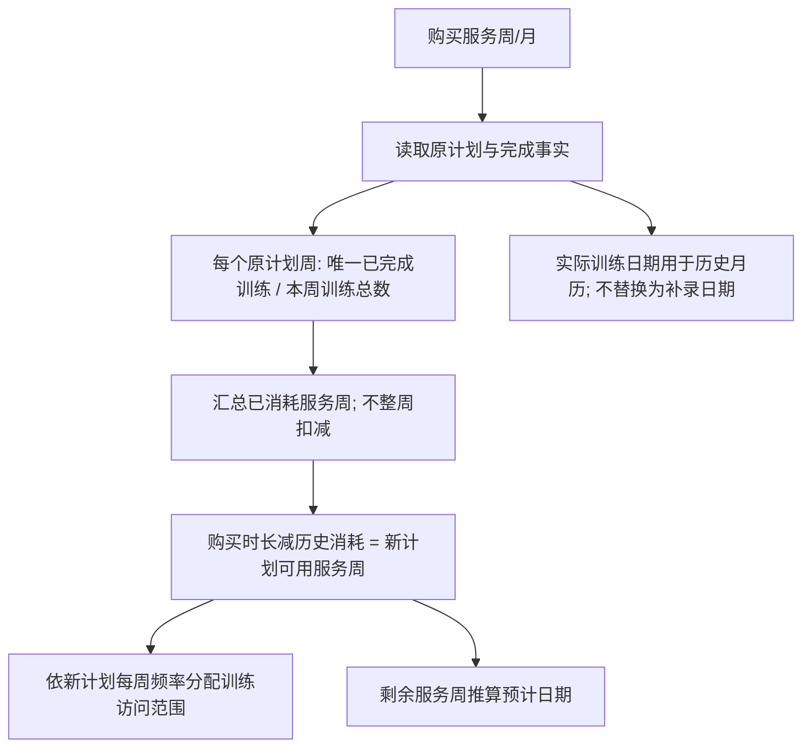

# 服务周结转修复（2026-09-28，本地未发布）

## 确认的规则

购买单位为服务周/月，不是固定训练次数。原计划每周3练时，完成1次消耗1/3服务周；4周剩3又2/3周。未完成份额顺延，跨频率保留服务时长。没有改购买时月/周套餐的换算。

## 已修改

- `subscriptionServiceWeeks.ts`：原计划逐周比例、唯一D去重、线下起点与完成记录取并集；休息/跳过/进行中不扣服务周。
- `subscriptionCarryover.ts`：批量读取历史原计划，按比例结转；缺原计划或查询失败明确报错，不能当成零消耗。
- `subscriptionCredits.ts`、`subscriptionEntitlementModel.ts`、`subscriptionAccess.ts`：部分周不再整周向下截断。最后不足一次的份额仍可访问一次训练，服务周余额不小于零。
- `subscriptionEstimatedEndDate.ts`：非整周剩余时长直接用于预计日期，避免四舍五入训练次数改变权益时长；整数周保留现有预测逻辑。
- `get-instance`：访问范围裁剪前保存原计划，用完整本周训练数作分母，保留真实小数服务周，不从最大D反推整数周。
- `skip-day`：读取全部attempt，任何已完成事实都不能覆盖；重复跳过幂等；读取失败关闭；更新带状态、归属、版本条件。

## 验证

- 新增 `service-week-carryover-regression.test.ts` 18项、`skip-completed-day-regression.test.ts` 9项；未修改已有测试。
- 全量59文件/363测试通过；typecheck通过；lint脚本仅提示未配置ESLint。
- Next构建545页通过；首次编译成功后因Windows EBUSY打包失败，重试成功。
- 新用例均为纯函数/数据库替身，不在业务库创建测试数据。不能以此替代真实事务和浏览器写入E2E。
- Web只读实测：port-manager既有端口3001，通过正常用户ID快速登录6196，明确显示本人和刘三乐；当前推进D71、周条D71至77，展开月历可见同日D53/D68、D57/D69与历史日期核对提示；刷新后仍为6196。未点击开始/完成/日期确认。截图：`artifacts/plan-service-weeks/6196-calendar-20260928.png`。本轮只使用内置浏览器，所要求的web-devtools技能不可用，按浏览器技能工作流替代；没有小程序UI实测。

## 6196只读核对

用户ID：`aaa90e01-7a53-444d-b374-9edfe438fa17`。

12服务周、原计划每周2次；20个唯一已完成训练日，剩2服务周，当前频率对应D71、D74、D78、D81共4次。此为事实派生核对，不是已写回的线上余额。D53/D57持久化日期仍为北京时间9/24、9/25；原计划只能证明D顺序，不能证明真实训练日期。

## 仍未闭环

1. 学员确认D53/D57实际训练日期；禁止排序后伪造日期。
2. 上轮日期补记RPC迁移尚未部署生产；本轮没有线上迁移、数据修复、提交、推送或发布。
3. Docker引擎未运行，本轮未运行真实隔离库完整UI/API写入验收；禁止指向生产执行测试写入。
4. 原计划原位修改可能改变历史周分母，长期应版本化冻结服务份额/对账流水。当前用已存原计划计算，不能承诺任意历史改频后余额绝不变化。
5. legacy推进兼容分支、CI允许失败的门禁仍需后续收口。不存在仅靠本轮363测试就能保证后续永远无问题的承诺。
