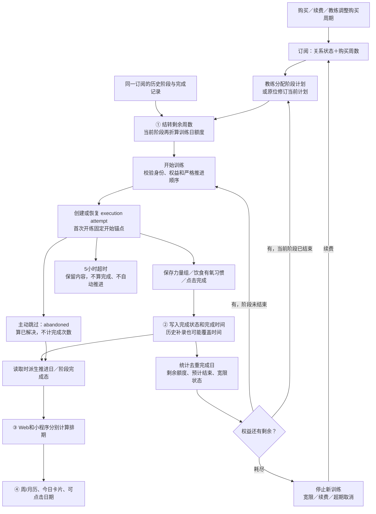
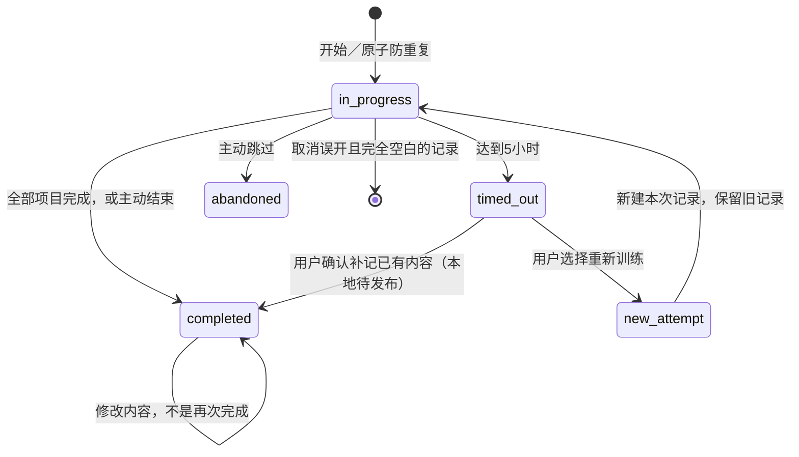

# 当前计划／订阅体系流程与修复边界

核对日期：2026-09-26。以下流程来自当前代码，不是重新设计后的理想流程。工作区已有 9/16 超时补记改动尚未发布；本文分别标明现状、已确认问题和本轮本地修改。

## 一、先说清现在卖的是什么

- 对外购买单位是 `subscribed_weeks`；内部按当前计划前 N 周包含的训练日折成 credits，完成训练日按 `day_index` 去重计入消耗。恢复日不按普通训练日扣额度。
- 订阅关系 `active`、当前阶段计划是否完成、剩余训练权益，是三个不同状态。阶段完成但仍有后续权益时可以继续分配下一阶段。
- 订阅创建时通常不填写实际开始日期；首次真实开始训练才设置订阅开始时间，新阶段计划也有自己的日历起点。
- `end_date` 主要是预计完成日和耗尽后的生命周期输入，不是“购买 4 周，第 29 天禁止训练”。剩余权益大于零时不能只看这个日期阻断。
- 额度耗尽后不再允许继续新训练；现有模型区分宽限期和超期取消，宽限常量为 14 天。续费增加周数并重算派生结果，不简单把 end_date 加 N 天。
- 当前阶段内按训练次数，跨历史阶段却按已完成记录覆盖的周跨度和迁移起点折算周数。这是需要明确产品算例的接缝，不宜直接改成另一种余额算法。

## 二、当前主流程（修复前）

### 与代码的对应关系

| 过程 | 主要实现 |
| --- | --- |
| 订阅创建、购买确认、续费 | `src/app/api/subscription/create-subscription/route.ts`、`src/lib/subscriptionOrders.ts`、`src/app/api/subscription/renew-subscription/route.ts`；平台付款确认另有支付履约入口 |
| 阶段分配、原位修订、激活 | `src/app/api/plan-lib/create-instance/route.ts`、`update-instance/route.ts`、`activate-instance/route.ts`、`src/lib/planExecutionLifecycle.ts` |
| 历史结转 | `src/lib/subscriptionCarryover.ts` |
| 当前训练日配额与权益状态 | `src/lib/subscriptionCredits.ts`、`subscriptionEntitlementModel.ts`、`subscriptionAccess.ts` |
| 开始和恢复 | `src/app/api/execution/start/route.ts`，数据库 `create_plan_execution_atomic` |
| 保存和完成 | `src/app/api/execution/complete-set/route.ts`、`complete-item/route.ts`、`finish/route.ts` |
| 超时补记 | 本地 `finish/route.ts` 和 `20260916010000_complete_timed_out_execution.sql`，尚未发布 |
| 推进与阶段完成 | `src/lib/planProgress.ts`、`planInstanceCompletion.ts`，主要由 `plan-lib/get-instance` 返回派生状态 |
| Web排期 | `src/app/today-training/lib/dayModules.ts` |
| 小程序排期与今日选择 | `apps/wechat/src/training/today-training/lib/dayModules.ts`、`TodayTrainingScreen.tsx` |
| 预计日期与自动取消 | `execution/updateEstimatedEndDate.ts`、`subscriptionEntitlementSnapshot.ts`、`subscription/check-expired-subscriptions/route.ts` |

## 三、记录状态怎么流转

`abandoned` 目前还被用来关闭超时补记后的空白替代 attempt，因此“某次 attempt 被关闭”与“整个计划日主动跳过”并不完全等价。这个状态复用需要在后续计划日模型中拆开。

纯恢复日不一定产生 execution：严格推进函数按前一日解决时间计算恢复日何时结束；用户主动进入后面的首个训练日可跨连续恢复日。带饮食/有氧/习惯任务的恢复日还涉及任务完成判定。现有开始接口的手动跨越判断只检查 day.type，与严格推进函数检查轻量任务的粒度也不完全相同，后续统一时必须单独测试，不能静默改变用户既有行为。

## 四、哪里不合理

| 问题 | 为什么会出错 | 本轮处理 |
| --- | --- | --- |
| ① 周数与训练次数之间的结转 | 部分周完成后换计划，旧算法按整周跨度扣除；频率变化仍缺统一换算 | 用户已确认保留未完成权益（12次做1次应剩11次），结转代码尚未切换；不能只改小数周数后继续被下游整周截断 |
| ② 编辑内容被当作再次完成 | complete-set/item 重写 completed_at；推进、恢复日与月历又依赖该时间 | 已本地修复普通补录不改变首次完成事实；未知历史日期不伪造为今天 |
| 保存采用读取整段 JSON 再无条件覆盖 | 两设备保存、最后一组与 finish 并发、处理期间超时，会丢记录或覆盖先完成结果 | 三个完成入口增加版本＋状态＋归属条件更新；冲突返回409；finish重试返回已完成结果 |
| ③ 两端各算日期 | Web 累加延迟，小程序使用自身时间游标/压缩模型；时区工具也不同 | 本轮未改客户端；必须以共享规则逐步替换，不宣称已有两端一致性 |
| ④ 展示与权限混在一起 | “当前逻辑周＋下一周”的未来预览锁，也可能挡住较后Day的已完成历史；今日补录抢占今日卡片 | 本轮未改 UI；历史查看、未来预览、开练必须分开处理 |
| attempt选择和推进事实混用 | get-instance 使用状态优先级，start 的推进映射按遍历覆盖；显示哪次记录会影响推进 | 后续需要区分“当前显示attempt”和“计划日已确认事实”，不能简单把所有地方改成取最新或最大Day |
| 查询错误当作空历史 | 可能算成全部未消耗，或用不完整历史刷新生命周期 | 已修复结转、执行权限、快照刷新、预计日期刷新、过期扫描的相关查询错误路径 |
| 辅助快照刷新与主操作结果混同 | 续费已入库但日期刷新失败，如果整单返回失败，会诱发重试 | 快照刷新失败保留原快照、返回未知并记录错误，不把已提交的主操作包装成失败 |
| 已完成日可被其他旧入口重新改状态 | skip-day 当前仍可能把旧完成记录改为 abandoned；还没有独立的计划日确认表/原子跳过命令 | 仍待后续状态机收口，不能宣称数据库已从所有入口保证完成事实不变 |
| 旧规范、旧 fallback、CI并存 | 旧 maxCompleted 规范仍标已拍板；legacy nextDayIndex与严格recommended并存；CI允许测试失败 | 文档已标明冲突；本轮未擅自修改已有测试配置或发布工作流 |

## 五、本轮已做的修改（本地，未发布）

1. 新增 `src/lib/executionCompletion.ts`：统一自动完成的状态转换；只有 in_progress 首次变 completed 才生成完成时间。已完成记录的内容可以继续修正，但不会重新推进或重算订阅日期。
2. 新增 `execution/_helpers/conditionalUpdate.ts`：利用现有数据库 updated_at 触发器做乐观并发控制；请求持有旧版本、状态已变或超过5小时，不再无条件写回。
3. complete-set / complete-item 保留未随请求提交的重量、次数、视频、备注等字段，避免局部补录把其他字段擦掉；拒绝把 abandoned 或 timed_out 靠普通保存隐式改成完成。
4. PR/1RM辅助更新移到训练保存成功之后；辅助结果写回也受版本保护，不覆盖更新后的训练。此处不是完整的PR流水事务改造，不能据此宣称所有外部副作用已幂等。
5. finish 普通完成采用条件更新；另一请求先完成则返回已存在结果，不覆盖日期。超时补记即使收到 quick 参数，也不自动补齐未做的组；仍复用此前本地的补记RPC。
6. 对订阅读取错误做失败保护；预计日期计算补读真实完成时间，不再只查询 day_index/status 后推测耗尽日期。

没有修改套餐价格、支付渠道、结转换算规则；没有改这个学员的真实记录，没有执行迁移、提交、推送或部署。当前的月历展示差异和历史脏时间不会因保存入口修复就自动消失。

## 六、验证与下一步

- 用户本轮已确认：换计划保留未完成的训练权益。固定算例为4周×每周3次＝12次，完成1次即换阶段仍有11次；不按触及的整周扣除。次数结转、不同频率和线下迁移要通过明确算例后统一接入，不直接修改真实学员余额。
- 先新增接口回归，确认旧代码 7 项中 6 项失败，再修业务代码；不是只写一个永远通过的辅助函数测试。
- 新增回归覆盖：历史补录十次、首次完成后的跨周重试、旧日期缺失、已结束状态、并发保存、finish竞态、5小时边界、局部字段保留、查询错误不得恢复额度/改变快照/调整订阅。
- 两个新增文件共 23 项回归；最终全量 Vitest 55 files / 297 tests、typecheck 通过。本轮 Next 544 页生产构建通过；lint 命令只输出未配置 ESLint 的提示，不能当作真实静态 lint 已通过。
- 这些接口测试使用数据库替身模拟条件更新；它们不等于真实 PostgreSQL/PostgREST 并发验收。数据库技能要求验证写入，因此真实隔离库测试仍列为发布前阻塞项。
- 本机 Docker Linux 引擎未运行；本地 Apollo 配置指向远端业务 Supabase，不能直接运行会造数据的旧 E2E。既有 E2E 的 cleanup 还是 best-effort，不能靠它保证远端零残留。
- 后续先在隔离库验证 updated_at 触发器与条件更新、补记RPC、并发与清理，然后修复统一日历/历史查看，并按上述已确认规则收口次数结转。不要直接把用户进度强行改成 D68，也不要猜测 D57 的实际训练日。

完整验收矩阵见 [一致性整改方案](./plan-subscription-consistency-2026-09-26.md)。本轮遵循的接口机制参考：[Supabase 条件更新](https://supabase.com/docs/reference/javascript/update)、[Next.js Route Handlers](https://nextjs.org/docs/app/getting-started/route-handlers)；业务规则依据仓库代码和较新的 `DECISIONS.md`，不是外部文档。
