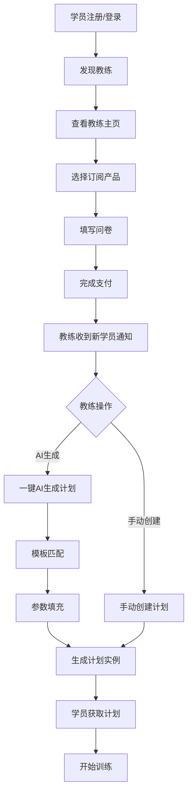
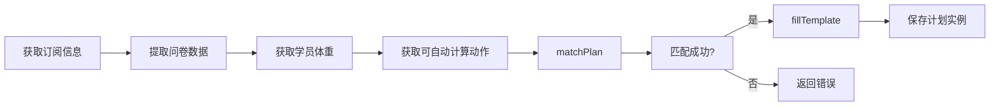
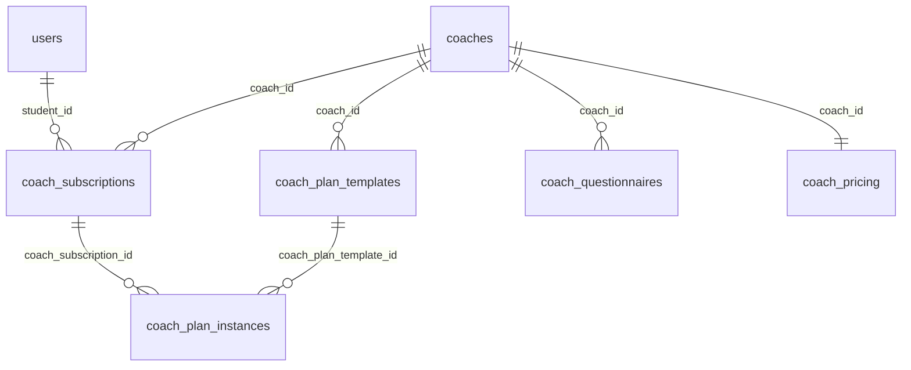

# CoachLink 学员订阅与计划生成流程总结

> **文档版本**: 1.0\
> **更新日期**: 2025-12-26\
> **适用范围**: CoachLink 平台学员端、教练端、管理员端

---

## 目录

1. [流程概述](#流程概述)
2. [详细流程步骤](#详细流程步骤)
3. [AI 计划生成与匹配逻辑](#ai-计划生成与匹配逻辑)
4. [涉及的核心代码文件](#涉及的核心代码文件)
5. [数据库表结构](#数据库表结构)

---

## 流程概述

```
学员注册 → 发现教练 → 选择产品/套餐 → 填写问卷 → 支付 → 教练确认 → AI生成计划 → 学员获取计划
```



---

## 详细流程步骤

### 第一步：学员注册与填写初始信息

学员通过手机号注册账号后，需要完成初始问卷（Onboarding），填写基本信息：

- **基本信息**: 昵称、性别、年龄、身高、体重
- **训练目标**: 健身目标（增肌、减脂、力量提升等）
- **训练水平**: 初学者、中级、高级
- **生活作息**: 工作类型、作息习惯

**相关代码文件**:

- 用户档案 API: `src/app/api/user/get-profile/route.ts`
- 入职问卷提交: `src/app/api/user/submit-onboarding/route.ts`

**数据库表**:

- `users`: 用户基本账号信息
- `user_profiles`: 用户详细档案（体重、身高、训练水平等）

---

### 第二步：发现教练

学员进入**教练发现页**，可以：

- **搜索教练**: 按名称、专业领域搜索
- **筛选教练**: 按专业领域（力量训练、健美塑形等）筛选
- **查看教练卡片**: 显示教练头像、名称、专长、评分、学员数量

**相关代码文件**:

- 教练发现页面: `src/app/coach/discovery/page.tsx`
- 教练服务: `src/app/service/coachService.ts`
- 教练列表 API: `src/app/api/coach/list-coaches/route.ts`

**数据库表**:

- `coaches`: 教练基本信息（名称、头像、专长、评分等）
- `specialties`: 教练专业领域

---

### 第三步：订阅教练（选择产品）

学员进入教练主页后，可以查看教练设置的订阅产品：

| 层级     | 名称       | 说明                     |
| -------- | ---------- | ------------------------ |
| basic    | 特惠基础版 | 低价体验，适合自主训练   |
| standard | 专业指导版 | 包含教练指导与沟通       |
| vip      | 全能指导版 | 不限项目，全方位托管服务 |

学员选择产品后，还需选择订阅时长（如
1个月、3个月、6个月），系统根据时长计算价格。

**相关代码文件**:

- 订阅组件: `src/app/coach/profile/[id]/CoachSubscription.tsx`
- 教练定价 API: `src/app/api/coach/get-pricing/route.ts`
- 定价实体: `src/app/api/coach/get-pricing/entity.ts`

**数据库表**:

- `coach_pricing`: 教练收费套餐（存储产品列表 JSON）

---

### 第四步：填写问卷

选择产品后，学员需要填写**教练设置的专属问卷**。问卷类型包括：

| 问卷类型 | 说明         | 示例                             |
| -------- | ------------ | -------------------------------- |
| `tags`   | 标签选择     | 选择训练方向：引体负重、力量举等 |
| `times`  | 每周训练次数 | 3次/周、4次/周、5次/周           |
| `option` | 动作选择     | 主项选择：负重引体 vs 负重臂屈伸 |
| `rm`     | 1RM数据输入  | 各动作的极限重量                 |
| `text`   | 文本输入     | 自由填写的文本问题               |

> **注意**: `option` 类型的问题如果带有
> `scope: 'global'`，则为全局问题（如训练水平），在 AI 匹配时会被排除。

问卷数据将用于后续的**模板匹配**和**参数填充**。

**特殊功能**:

- **问卷数据回显**: 如果学员之前已填写过问卷，再次打开问卷时会自动回显之前的数据
- **RM 动作列表**: RM 问题显示的动作列表来自教练设置的 `coach_actions` 中
  `enableAutoWeightCompute=true` 的动作

**相关代码文件**:

- 问卷表单组件: `src/app/coach/profile/[id]/QuestionnaireForm.tsx`
- 获取问卷 API: `src/app/api/coach/get-questionnaires/route.ts`
- 获取自动计算动作 API:
  `src/app/api/action-lib/list-auto-compute-actions/route.ts`
- 问卷类型定义: `src/types/questionnaires.ts`

**数据库表**:

- `coach_questionnaires`: 教练专属问卷配置
- `coach_actions`: 教练动作库（存储 `enableAutoWeightCompute` 和
  `includesBodyWeight` 标记）

---

### 第五步：支付

问卷填写完成后，进入支付环节：

1. **创建订阅记录**: 调用 `create-subscription` API，状态设为
   `inactive`，同时保存问卷数据（`subscribe_data`）、产品信息（`product_id/product_name/product_tier`）和订阅周数（`subscribed_weeks`）
2. **显示支付页面**: 展示支付二维码或支付方式
3. **完成支付**: 学员使用微信或支付宝扫码支付
4. **更新订阅状态**: 调用 `update-subscription` API，状态变为
   `waiting`，同时设置 `has_remind_coach=true` 通知教练
5. **系统发送通知**: 自动向教练发送系统消息，提示有新学员订阅

**相关代码文件**:

- 支付对话框: `src/components/payment/paymentDialog.tsx`
- 支付页面: `src/app/payment/[id]/page.tsx`
- 创建订阅 API: `src/app/api/subscription/create-subscription/route.ts`
- 更新订阅 API: `src/app/api/subscription/update-subscription/route.ts`
- 支付宝服务: `src/app/service/alipayService.ts`
- 系统消息: `src/lib/chat.ts` (`sendSystemMessage` 函数)

**数据库表**:

- `coach_subscriptions`: 教练订阅关系（存储订阅状态、问卷数据等）
- `alipay_orders`: 支付订单记录

**订阅状态流转**:

```
inactive → waiting → active → (paused/cancelled/expired)
```

> **续费场景**: 如果是续费（URL 带有 `renew=true` 或
> `extend=true`），则跳过问卷直接进入支付，调用 `renew-subscription` API
> 延长订阅时间

---

### 第六步：教练确认（管理端操作）

教练登录后台后，可以在**学员管理页**看到新订阅的学员：

1. **查看待确认学员**: 显示等待支付确认的学员列表
2. **确认支付**: 教练或管理员确认学员已完成支付
3. **激活订阅**: 订阅状态从 `waiting` 变为 `active`

> 注：当前系统设计为教练手动确认，未来可对接自动支付回调。

**相关代码文件**:

- 学员管理页面: `src/app/dashboard/students/page.tsx`
- 支付确认对话框: `src/app/dashboard/students/PaymentConfirmationDialog.tsx`
- 待确认学员 API: `src/app/api/coach/get-payment-waiting-students/route.ts`

---

### 第七步：教练看到新学员

支付确认后，教练在**学员管理页**可以看到新学员信息：

- **学员头像和昵称**
- **订阅产品和套餐**
- **订阅时长和预计完成日期**
- **问卷数据**（点击可查看详情）
- **训练计划状态**（未创建/已创建）

**相关代码文件**:

- 学员管理页面: `src/app/dashboard/students/page.tsx`
- 学员列表 API: `src/app/api/coach/list-students/route.ts`
- 学员详情对话框: `src/app/dashboard/students/StudentDetailDialog.tsx`

---

### 第八步：AI 生成计划（一键生成）

教练可以选择两种方式为学员创建计划：

1. **手动创建**: 点击"创建计划"，进入计划编辑器手动配置
2. **AI 生成**: 点击"AI 生成"，系统自动匹配模板并填充参数

AI 生成的完整处理流程：



**AI 生成 API 处理步骤**：

1. **获取订阅信息**: 从 `coach_subscriptions` 获取订阅详情，包括
   `subscribe_data`（问卷数据）
2. **获取学员体重**: 从 `user_profiles` 获取 `weight` 字段
3. **获取自动计算动作**: 从 `coach_actions` 获取 `enableAutoWeightCompute=true`
   的动作，包含 `includesBodyWeight` 属性
4. **调用 matchPlan**: 根据问卷数据匹配最佳模板
5. **调用 fillTemplate**: 填充模板参数，自动计算负重
6. **保存计划实例**: 写入 `coach_plan_instances` 表

**相关代码文件**:

- AI 生成入口: `src/app/dashboard/students/page.tsx` (`makeAiInstance` 函数)
- AI 生成 API: `src/app/api/plan-lib/create-ai-instance/route.ts`
- 匹配与填充逻辑: `src/app/api/plan-lib/create-ai-instance/match.ts`
- 计划库服务: `src/app/service/planLibService.ts`

---

## AI 计划生成与匹配逻辑

### 匹配逻辑详解 (`matchPlan` 函数)

AI
生成计划的核心是**模板匹配**，系统根据学员问卷数据从教练的模板库中找到最匹配的模板。

#### 匹配条件

1. **标签匹配 (tags)**
   - 学员选择的训练方向标签（如"引体负重"）
   - 模板必须包含学员选择的所有标签
   - 使用 PostgreSQL 的 `contains` 操作符

2. **每周训练次数匹配 (times)**
   - 学员选择的每周训练天数
   - 模板的 `week_days` 字段包含该天数

3. **动作选择匹配 (option)**
   - 学员选择的动作类型问题
   - 模板的 `contained_options` 必须被学员问卷覆盖

#### 匹配代码逻辑

```typescript
// src/app/api/plan-lib/create-ai-instance/match.ts

export async function matchPlan(questionare: TrainingItem[]) {
    let query = supabase.from("coach_plan_templates").select("*");

    // 1. 标签匹配
    const tagsInfo = questionare.find((item) => item.type === "tags");
    if (tagsInfo?.userSelections?.length > 0) {
        query = query.contains("tags", tagsInfo.userSelections);
    }

    // 2. 每周训练次数匹配
    const timesInfo = questionare.find((item) => item.type === "times");
    if (timesInfo) {
        query = query.contains("week_days", [timesInfo.userSelection]);
    }

    // 3. 应用层过滤：检查 contained_options
    const optionInfos = questionare.filter((item) =>
        item.type === "option" && item.scope !== "global"
    );
    const questionNames = optionInfos.map((o) => o.question);

    const { data: planTemplates } = await query;

    // 过滤：模板的 contained_options 必须被学员问卷覆盖
    const filteredTemplates = planTemplates?.filter((template) => {
        const containedOptions = template.contained_options || [];
        if (containedOptions.length === 0) return true;
        return containedOptions.every((opt) => questionNames.includes(opt));
    });

    return filteredTemplates;
}
```

### 参数填充逻辑 (`fillTemplate` 函数)

模板匹配成功后，系统会根据学员问卷数据填充模板参数。

#### 填充内容

1. **动作选择填充**
   - 根据学员选择的动作类型，从模板的多选项中选择对应动作
   - 例如：模板有"负重引体"和"负重臂屈伸"两个选项，根据学员选择填充

2. **负重自动计算**
   - 根据学员的 1RM 数据和模板设置的强度（RM 次数）
   - 使用 `calcRecommendedLoad` 函数计算具体训练重量
   - 考虑动作类型：负重动作（引体向上）需要减去体重

#### 负重计算公式

```typescript
// 根据动作的 includesBodyWeight 属性决定 alpha 值
// true = 负重动作（引体/臂屈伸），需要减去体重 → alpha=1
// false/null = 普通动作（深蹲/卧推/硬拉） → alpha=0

const alpha = actionConfig.includesBodyWeight ? 1 : 0;

const calculatedWeight = calcRecommendedLoad(
    oneRM, // 学员该动作的 1RM
    bodyWeight, // 学员体重
    rmValue, // 模板设置的 RM 次数（强度）
    alpha, // 体重系数
    "average", // 计算模式
);
```

#### 填充代码逻辑

```typescript
// src/app/api/plan-lib/create-ai-instance/match.ts

export function fillTemplate(
    answers: TrainingItem[],
    template: CoachPlanTemplateRow,
    options?: FillTemplateOptions,
) {
    // 建立动作选择索引
    const optionNameMapUserSelection: Record<string, number> = {};
    for (const optionInfo of answers.filter((item) => item.type === "option")) {
        optionNameMapUserSelection[optionInfo.question] =
            optionInfo.userSelection;
    }

    // 获取学员 1RM 数据
    const rmData = answers.find((item) => item.type === "rm");
    const userRmInputs = rmData?.userInputs || {};

    // 遍历模板的每一天
    for (const day of template.training_days) {
        const specificActionSet = [];

        for (const actionSet of day.actionSets) {
            if (actionSet.type === "one-filter") {
                // 根据学员选择，从多个动作中选择一个
                const userSelection =
                    optionNameMapUserSelection[actionSet.question.question];
                const selectedAction = actionSet.actions[userSelection];
                // 计算具体负重
                computeActionWeight(selectedAction, userRmInputs, options);
                specificActionSet.push(selectedAction);
            } else if (actionSet.type === "no-filter") {
                // 固定动作，直接计算负重
                computeActionWeight(actionSet, userRmInputs, options);
                specificActionSet.push(actionSet);
            }
        }

        day.actionSets = specificActionSet;
    }
}
```

---

### 第九步：学员获取计划

AI
生成完成后，系统创建一个**计划实例**（`coach_plan_instances`），学员可以在学员端看到自己的训练计划：

- **计划名称**: "AI 生成计划"
- **训练日程**: 每天的训练内容
- **动作详情**: 动作名称、组数、次数、建议重量
- **执行状态**: 可跟踪每天的完成情况

**相关代码文件**:

- 学员训练首页: `src/components/training/TrainingHub.tsx`
- 今日训练页面: `src/app/today-training/page.tsx`
- 计划执行视图: `src/components/training/StudentPlanExecutionView.tsx`
- 获取计划实例 API: `src/app/api/plan-lib/get-instance/route.ts`

**数据库表**:

- `coach_plan_instances`: 计划实例（从模板生成的学员专属计划）

---

## 涉及的核心代码文件

### 学员端

| 文件路径                                           | 说明                       |
| -------------------------------------------------- | -------------------------- |
| `src/app/coach/discovery/page.tsx`                 | 教练发现页面               |
| `src/app/coach/profile/[id]/page.tsx`              | 教练主页                   |
| `src/app/coach/profile/[id]/CoachSubscription.tsx` | 订阅组件（选择产品、时长） |
| `src/app/coach/profile/[id]/QuestionnaireForm.tsx` | 问卷表单组件               |
| `src/app/payment/[id]/page.tsx`                    | 支付页面                   |
| `src/components/training/TrainingHub.tsx`          | 训练首页                   |
| `src/app/today-training/page.tsx`                  | 今日训练页面               |

### 教练端

| 文件路径                                                   | 说明           |
| ---------------------------------------------------------- | -------------- |
| `src/app/dashboard/students/page.tsx`                      | 学员管理页面   |
| `src/app/dashboard/students/StudentDetailDialog.tsx`       | 学员详情对话框 |
| `src/app/dashboard/students/PaymentConfirmationDialog.tsx` | 支付确认对话框 |
| `src/app/dashboard/plan-lib/`                              | 计划模板库管理 |
| `src/app/dashboard/questionnaire/page.tsx`                 | 问卷管理页面   |

### API 接口

| 文件路径                                                | 说明               |
| ------------------------------------------------------- | ------------------ |
| `src/app/api/subscription/create-subscription/route.ts` | 创建订阅           |
| `src/app/api/subscription/update-subscription/route.ts` | 更新订阅状态       |
| `src/app/api/plan-lib/create-ai-instance/route.ts`      | AI 生成计划        |
| `src/app/api/plan-lib/create-ai-instance/match.ts`      | 模板匹配与填充逻辑 |
| `src/app/api/coach/get-questionnaires/route.ts`         | 获取教练问卷       |
| `src/app/api/coach/list-students/route.ts`              | 获取学员列表       |

### 服务层

| 文件路径                                 | 说明       |
| ---------------------------------------- | ---------- |
| `src/app/service/subscriptionService.ts` | 订阅服务   |
| `src/app/service/coachService.ts`        | 教练服务   |
| `src/app/service/planLibService.ts`      | 计划库服务 |
| `src/app/service/alipayService.ts`       | 支付宝服务 |

### 工具函数

| 文件路径                 | 说明                  |
| ------------------------ | --------------------- |
| `src/lib/rmCaculator.ts` | RM 计算器（负重计算） |

---

## 数据库表结构

### 核心表关系



### 关键表字段

#### coach_subscriptions（订阅关系表）

| 字段             | 类型        | 说明                                      |
| ---------------- | ----------- | ----------------------------------------- |
| id               | uuid        | 主键                                      |
| student_id       | uuid        | 学员ID                                    |
| coach_id         | uuid        | 教练ID                                    |
| tier             | integer     | 套餐层级（1=basic, 2=standard, 3=vip）    |
| status           | text        | 状态（inactive/waiting/active/completed） |
| monthly_price    | numeric     | 订阅价格                                  |
| subscribe_data   | jsonb       | 学员问卷数据                              |
| product_id       | text        | 产品ID                                    |
| product_name     | text        | 产品名称                                  |
| subscribed_weeks | integer     | 订阅周数                                  |
| start_date       | timestamptz | 开始日期                                  |
| end_date         | timestamptz | 结束日期                                  |

#### coach_plan_templates（计划模板表）

| 字段              | 类型    | 说明                 |
| ----------------- | ------- | -------------------- |
| id                | uuid    | 主键                 |
| coach_id          | uuid    | 教练ID               |
| name              | text    | 模板名称             |
| tags              | text[]  | 标签数组（用于匹配） |
| week_days         | int[]   | 支持的周训练天数     |
| contained_options | text[]  | 包含的动作选择问题   |
| training_days     | jsonb[] | 训练日配置           |

#### coach_plan_instances（计划实例表）

| 字段                   | 类型        | 说明               |
| ---------------------- | ----------- | ------------------ |
| id                     | uuid        | 主键               |
| coach_subscription_id  | uuid        | 关联的订阅ID       |
| coach_plan_template_id | uuid        | 来源模板ID         |
| coach_id               | uuid        | 教练ID             |
| student_id             | uuid        | 学员ID             |
| name                   | text        | 计划名称           |
| training_days          | jsonb       | 填充后的训练日数据 |
| status                 | text        | 计划状态           |
| start_date             | timestamptz | 开始日期           |

---

## 总结

CoachLink 平台的学员订阅与计划生成流程是一个完整的闭环系统：

1. **学员端**: 注册 → 发现教练 → 订阅 → 填写问卷 → 支付
2. **教练端**: 查看新学员 → 确认支付 → 创建/AI生成计划
3. **AI 引擎**: 根据问卷数据匹配模板 → 填充个性化参数 → 生成实例
4. **学员端**: 获取专属计划 → 开始执行训练

这个流程既保证了教练的高效工作（模板复用 + AI
辅助），又为学员提供了个性化的训练体验（问卷驱动 + 参数自动计算）。
