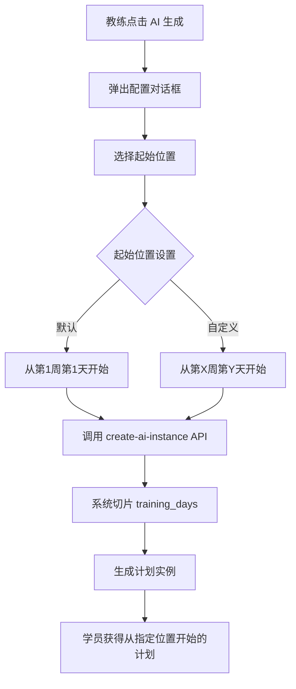

# CoachLink 落地细节问题 - 2025年12月26日

> **文档版本**: 1.0\
> **创建日期**: 2025-12-26\
> **适用范围**: CoachLink 平台教练端

---

## 问题一：老学员中途接手，如何高效过渡计划？

### 问题背景

当一个教练已经有学员在线下执行某个训练模板，该学员已完成了计划的前一部分（例如12周计划中的第3周第4天），现在希望将其迁移到
CoachLink 平台继续执行。

**当前痛点：**

- 如果先生成完整的12周计划，再手动逐个删除已执行的内容（3周3天），非常低效
- 手动删除容易出错，比如误删未来的训练日
- 数据库会先写入大量冗余数据再删除，性能浪费

### 解决方案：「指定起始位置」功能

**核心思路**：在生成计划时，允许教练选择"从第X周第Y天开始"，系统在**生成时**就切片数据，而非事后删除。

---

### 实现方案详解

#### 1. 用户交互流程



#### 2. 前端修改

**文件**: `src/app/dashboard/students/page.tsx`

**当前代码（第157-186行）**:

```typescript
const makeAiInstance = async (student: StudentWithPlan) => {
    showToast({
        severity: "info",
        summary: "AI 生成中",
        detail: "正在根据学员问卷自动创建训练计划",
    });
    const res = await planLibService.createAiInstance({
        subscriptionId: student.id,
    });
    // ...
};
```

**修改方案**:

1. 点击"AI 生成"时，弹出一个配置对话框（不是直接调用API）
2. 对话框中提供起始位置选择器：
   - **下拉框1**: 选择起始周（默认"第1周"）
   - **下拉框2**: 选择起始天（默认"第1天"）
   - **复选框**: "保留原始周次编号"（默认勾选）
3. 点击确认后，带上新参数调用API

**新增组件**: `AiInstanceConfigDialog.tsx`

```typescript
interface AiInstanceConfigDialogProps {
    visible: boolean;
    student: StudentWithPlan;
    onHide: () => void;
    onConfirm: (
        config: {
            startWeek: number;
            startDay: number;
            keepOriginalIndex: boolean;
        },
    ) => void;
}
```

#### 3. API 修改

**文件**: `src/app/api/plan-lib/create-ai-instance/entity.ts`

**当前代码**:

```typescript
export interface CreateAiInstanceDto {
    subscriptionId: string;
}
```

**修改为**:

```typescript
export interface CreateAiInstanceDto {
    subscriptionId: string;
    /** 起始周，从1开始计数，默认为1 */
    startWeek?: number;
    /** 起始天，从1开始计数（1-7代表周内第几天），默认为1 */
    startDay?: number;
    /** 是否保留原始周次编号，默认true */
    keepOriginalIndex?: boolean;
}
```

**文件**: `src/app/api/plan-lib/create-ai-instance/route.ts`

**修改逻辑**:

1. 从请求体解析 `startWeek`、`startDay`、`keepOriginalIndex`
2. 在 `fillTemplate` 之后，对 `training_days` 数组进行切片
3. 计算切片起始索引：`startIndex = (startWeek - 1) * 7 + (startDay - 1)`
4. 切片：`slicedDays = training_days.slice(startIndex)`
5. 如果 `keepOriginalIndex === false`，重新编号各天

**伪代码**:

```typescript
// 新增参数
const {
    subscriptionId,
    startWeek = 1,
    startDay = 1,
    keepOriginalIndex = true,
} = await req.json();

// ... 匹配和填充模板逻辑 ...

// 切片逻辑
let trainingDays = selectTemplate.training_days as any[];
const startIndex = (startWeek - 1) * 7 + (startDay - 1);

if (startIndex > 0 && startIndex < trainingDays.length) {
    trainingDays = trainingDays.slice(startIndex);

    // 如果不保留原始编号，需要重新计算 dayIndex
    if (!keepOriginalIndex) {
        trainingDays = trainingDays.map((day, idx) => ({
            ...day,
            // 根据你的数据结构决定是否需要更新 dayIndex 等字段
        }));
    }
}

// 使用切片后的数据保存
await supabase.from("coach_plan_instances").insert({
    // ...
    training_days: trainingDays,
    // 可选：记录原始起始位置，方便后续显示
    metadata: { originalStartWeek: startWeek, originalStartDay: startDay },
});
```

#### 4. 数据结构说明

当前 `training_days` 是一个 JSON 数组，每个元素代表一天。模板的结构（来自
`coach_plan_templates`）:

| 数组索引 | 周  | 天  | 说明       |
| -------- | --- | --- | ---------- |
| 0        | W1  | D1  | 第1周第1天 |
| 1        | W1  | D2  | 第1周第2天 |
| ...      | ... | ... | ...        |
| 6        | W1  | D7  | 第1周第7天 |
| 7        | W2  | D1  | 第2周第1天 |
| ...      | ... | ... | ...        |

**切片示例**：

- 用户选择"从第3周第4天开始"
- 起始索引 = (3-1) × 7 + (4-1) = 14 + 3 = **17**
- 切片后的数组从原索引17开始

---

### 开发任务清单

#### Phase 1: API 层改造（后端）✅ 已完成

- [x] 修改 `CreateAiInstanceDto`，新增
      `startWeek`、`startDay`、`keepOriginalIndex` 参数
- [x] 修改 `create-ai-instance/route.ts`，在保存前对 `training_days` 进行切片
- [ ] 添加切片逻辑的单元测试（可后续补充）

#### Phase 2: 前端改造 ✅ 已完成

- [x] 新建 `AiInstanceConfigDialog.tsx` 对话框组件
- [x] 修改 `students/page.tsx`，将直接调用改为先弹对话框
- [x] 对话框UI：两个下拉框 + 一个复选框 + 确认/取消按钮
- [ ] 下拉框选项需要根据已匹配模板的总周数动态生成（可选优化）

#### Phase 3: 进阶优化（可后期做）

- [ ] 在 `coach_plan_instances` 表中新增 `original_start_week` 和
      `original_start_day` 字段，记录起始位置（便于后续统计）
- [ ] 学员端显示周次时，根据 `keepOriginalIndex` 决定显示"第X周"还是"第1周"

---

### 风险与注意事项

1. **边界检查**：需要验证 `startWeek` 和 `startDay` 不超过模板总天数
2. **数据完整性**：切片后的第一天需要保证 actionSets 完整
3. **向后兼容**：`startWeek` 和 `startDay`
   为可选参数，默认值保证旧调用方式不受影响

---

### 预期效果

**操作前**：教练需要先生成12周完整计划，再手动删除3周3天的内容（约24次删除操作）

**操作后**：教练在"AI生成"对话框中选择"从第4周第1天开始"，一键生成，0次手动删除

**效率提升**：单次操作从 ~5分钟 → ~10秒

---

## 问题二：外部计划（文本/Excel）如何快速导入？

> 待后续实现，将在本文档中补充方案。
